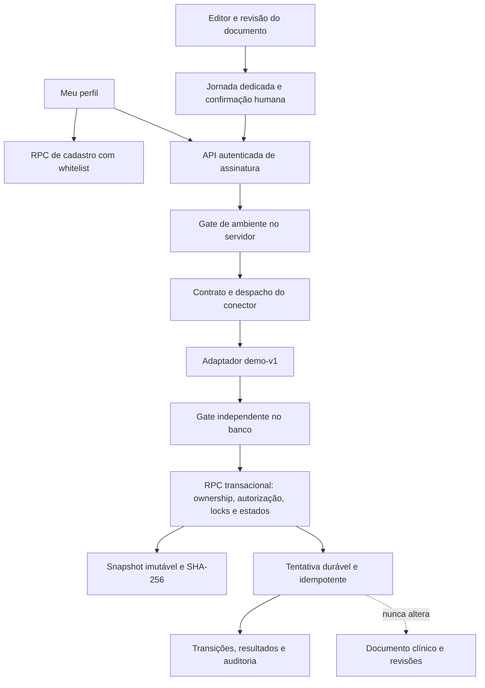
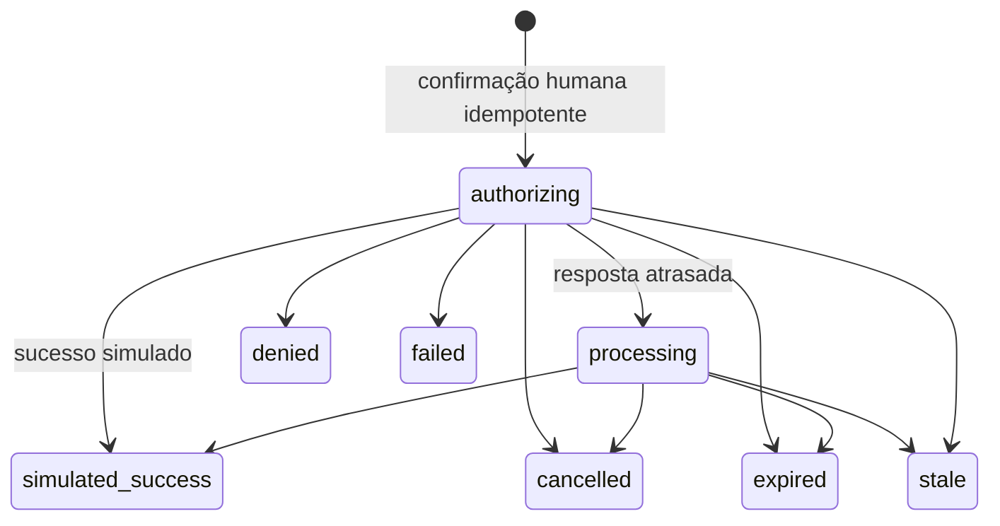

# Handoff 007.10.6B — Jornada demonstrativa de assinatura

20/11/2026. Implementação na branch `feat/handoff-007-10-6b-signing-journey`, sobre `4b3ea5f` (entrada Meu perfil), que contém a auditoria `509d68a` e a baseline consolidada `main`/`origin/main` `162b9a9`. Sem merge, push ou deploy. Dados exclusivamente fictícios nos testes e capturas.

## Entrega e uso

1. Abra nome/avatar → **Meu perfil**. Edite dados declarados, adicione inscrições e, no ambiente autorizado, conecte o simulador. Há duas identidades fictícias distintas do mesmo provedor, com preferência independente.
2. Crie ou abra uma prescrição, pedido cirúrgico ou solicitação de exames usando os editores existentes. Rascunhos já produzidos pelo Intelligence continuam sendo documentos normais.
3. Em um documento salvo, escolha **Revisar assinatura digital**. Revise o conteúdo integral e retorne à edição se necessário.
4. Escolha **Preparar versão demonstrativa**. O backend congela documento, tipo, versão, autoria histórica, atleta, conteúdo e timestamps em bytes JSON UTF-8 canônicos, com timestamps normalizados em UTC, calcula SHA-256 e registra uma preparação de 15 minutos. Nenhum status clínico é alterado.
5. Escolha explicitamente uma identidade. A preferencial é apenas identificada na lista, nunca selecionada automaticamente. Escolha o cenário demonstrativo, revise o resumo e confirme a autorização da simulação.
6. Consulte autorização/andamento/resultado. A resposta atrasada leva 8 segundos; pode ser cancelada. Falhas, negativa e expiração permitem preparar novamente. As últimas dez tentativas do documento possuem links de retomada; recarregar a URL preserva a consulta ao resultado.

A assinatura real continua **indisponível**. Não há integração Bird ID, chaves, OTPs ou conector de produção. A marca persistente na jornada é **DEMONSTRAÇÃO — DOCUMENTO NÃO ASSINADO DIGITALMENTE**. Não há PDF demonstrativo, QR, selo, assinatura visual ou artefato criptográfico fabricado. O preview HTML é do conteúdo preparado; o original permanece `draft` ou `ready_for_review`.

## Perfil profissional

`professional_details` complementa o perfil mínimo: nome completo, contato declarado e especialidades. Nome de exibição e profissão continuam em `public.profiles`, alterados exclusivamente por RPC com whitelist. Fotografia é decodificada, reorientada, limitada e convertida para PNG no servidor; bucket privado por usuário, limite 2 MB e 20 milhões de pixels de entrada. E-mail de acesso permanece no Auth, sem edição por esse formulário.

`professional_registrations` admite várias inscrições com conselho, número e jurisdição livres limitados (UF ou região). Novas inscrições são sempre `declared`; o usuário não envia verificação institucional. A remoção pelo próprio profissional só aceita inscrição declarada. Não foi criada uma interface de verificação institucional fictícia. A concessão operacional `medical_authors` e os vínculos `athlete_access` permanecem independentes; editar profissão, foto, inscrição ou conectar identidade não concede acesso.

A identificação médica legada é exibida como cadastrada, sem alegar verificação de conselho. Autoria de documentos antigos não é reescrita quando o perfil muda.

## Arquitetura



O adaptador simulado não realiza I/O de fornecedor. A tentativa persistida é a unidade durável de execução; consultas retomáveis conduzem as transições no banco. Não há dependência de memória do processo nem espera por rede dentro de uma transação. Não há worker, fila externa, outbox ou callback de produção nesta entrega. Esses mecanismos serão necessários ao incorporar um transporte real; a existência do contrato não deve ser apresentada como integração pronta.

### Dados implementados

| Entidade | Papel e proteção |
|---|---|
| `professional_details` | Complemento cadastral próprio, sem tokens ou permissões |
| `professional_registrations` | Várias inscrições por profissional; declaração separada de verificação |
| `signing_environment` | Gate de banco desligado por padrão; configuração somente por `service_role` |
| `signature_providers` | Catálogo extensível por chave, capacidades e proveniência |
| `signature_connections` | Vínculo próprio ao provedor, estado e epoch de autorização |
| `signing_identities` | Várias identidades por conexão/profissional; FKs compostas impedem misturas |
| `signature_preferences` | Uma preferência transacional por profissional e identidade própria |
| `signature_snapshots` | Bytes canônicos imutáveis, hash com CHECK, versão, autor, preparação e prazo |
| `signature_attempts` | Solicitação/execução demonstrativa, identidade congelada, confirmação, idempotência, cenário, epoch e estados |
| `signature_transitions` | Eventos de cada transição, ator, snapshot, identidade, origem e instante |
| `signature_results` | Evidência durável mínima de resultado; certificado não verificado, artefato não gerado, assinatura criptográfica falsa |
| `signature_artifacts` | Catálogo privado reservado, sem API de escrita/leitura nesta entrega. O simulador não insere objetos aqui |

Não há grants diretos para `authenticated`/`anon` nas tabelas novas; RLS habilitada. As RPCs derivam o ator de `auth.uid()`. Snapshots, tentativas, resultados e conexões não têm cascata destrutiva em suas referências. Não há endpoint de eliminação desses registros. A remoção de conta ou prontuário com esses vínculos exige política explícita futura; não foi implementada purga.

### Contratos e pontos de extensão

`src/features/signing/contracts.ts` define descoberta de capacidades, disponibilidade, conexão, listagem de certificados, autorização, solicitação, status, callback, resultado, validação, cancelamento e desconexão. Métodos não suportados são opcionais. O simulador declara `callbacks=false` e `cryptographicValidation=false`, sem no-op que alegue validação. Nenhum documento conhece URL ou payload de fornecedor.

Uma conexão real poderá ter fluxo por operação ou conexão persistente; não há coluna de token comum ou pressuposto de refresh token. Incluir Bird ID ou outro provedor exige conector de backend, autenticação/correlação verificáveis, gestão de segredos, reconciliador, obtenção privada do artefato e validador criptográfico independente, além da política clínica/institucional. Hoje não existe caminho que promova documentos a efetivamente assinados.

O ponto de extensão `DocumentDeliveryExtension` aceita exclusivamente um `VerifiedDeliveryArtifact` de produção validado. Não há implementação, endpoint, mensagem, dependência ou chamada à Z-API. Compartilhar será outra ação explícita depois de assinatura real e validação; uma simulação não satisfaz esse contrato.

## Segurança e estados

- Gate do servidor: `CBB_SIGNING_MODE=demo` **e** ambiente explícito `local`, `test` ou `controlled-demo`. Ausência, ambiente operacional ou Vercel production/preview desabilitam. `NODE_ENV=production` sozinho também se aplica aos builds locais do Next e não define o ambiente de implantação; por isso não é usado como autorização.
- Gate independente do banco: `demo_enabled=false` por padrão. Apenas o serviço confiável pode configurá-lo; um cliente não consegue habilitá-lo por RPC, URL ou payload. A implantação operacional deve conservar o padrão desligado em ambas as camadas. O script de configuração fornecido recusa Supabase não local.
- Escritas HTTP exigem sessão, perfil e origem/host iguais. JSON tem limite de 16 KB conferido no stream, além do header. Não são aceitos callbacks públicos.
- Preparar, consultar, confirmar, cancelar ou concluir revalida autoria do documento, autoria médica operacional e leitura do atleta no banco. Identidade, conexão, preferência, snapshot e tentativa são próprias.
- Um lock transacional por profissional e lock do documento serializam duas abas e concorrem com o editor existente. A chave idempotente não pode ser reutilizada com outra identidade, snapshot ou cenário. Um índice parcial impede duas operações em andamento para o mesmo snapshot; a RPC também impede operações simultâneas para o mesmo documento/versão em preparações diferentes, sob o lock do profissional.
- Hash, bytes e versão são conferidos novamente; mudança após preparação rejeita confirmação e invalida resposta pendente como `stale`. A versão editada nunca herda autorização antiga. Snapshots não aceitam UPDATE e o hash é conferido também por constraint.
- Conexão desconectada ou epoch alterado cancela operação pendente ao reconciliar; reconectar não ressuscita a tentativa. Cancelamento terminal e respostas repetidas não promovem o resultado.
- Campos `cryptographically_signed` e `certificate_verified` de tentativas/resultados são forçados a `false` por CHECK. O simulador não altera `clinical.documents`, `document_revisions` ou privilégios.
- Um erro de consulta interrompe o polling automático, preserva a tentativa e oferece consulta manual; conteúdo alterado recebe estado e orientação para preparar novamente.



O sucesso simulado é terminal operacional e **não** um estado clínico de assinatura. Retentar exige nova confirmação; não há troca silenciosa de identidade. A política demonstrativa usa os mínimos já existentes de `document_ready`, sem alegar completude clínica ou verificação de conselho para produção.

### Pendências P0 de conversas

A auditoria 007.10.4A registrou reativação de conversa encerrada, confirmação após arquivamento, ambiguidade de attach e acesso ao histórico após revogação. O código/RPCs atuais de retomada e confirmação ainda não constituem o contrato completo de bloqueio de sessão recomendado. Esses módulos não foram alterados neste handoff.

Por isso não foi registrada ferramenta de assinatura no agente, não foi criado comando de voz/IA, e nenhuma confirmação do transcript autoriza uma tentativa. A única entrada de assinatura é a jornada do documento, com revalidação clínica própria e confirmação humana. Um rascunho originado do Intelligence pode ser aberto nessa interface após ser salvo. Corrigir o ciclo de vida das conversas continua pré-requisito para uma futura iniciação de assinatura pelo chat.

## Auditoria

As mutações cadastrais e de assinatura usam `clinical.audit_events`, sem substituir eventos antigos. Edição de perfil é operação real de declaração (`simulated=false`); eventos de assinatura e rejeições são explicitamente simulados. Estados, documento/versão, snapshot, hash e identidade são referências mínimas. Resultados e transições são gravados na mesma transação da mudança operacional.

Nenhum OTP, senha, token, chave privada, e-mail, fotografia, conteúdo clínico integral ou payload de fornecedor é armazenado nos logs de assinatura. O snapshot clínico privado contém o conteúdo exato, separadamente da auditoria. O bucket de fotografia é privado; o backend nunca oferece seleção de profissional por query string.

## Evidências reais

Chromium **headless**, sem janela de navegador visível. Dados sintéticos criados e removidos pela suíte, inclusive foto geométrica fictícia. Capturas históricas regeneradas são restauradas; estas são as novas evidências desta entrega.

| Etapa | Desktop | Mobile |
|---|---|---|
| Perfil e identidades | [1440](visual/handoff-007-10-6b/perfil-1440.png) | [390](visual/handoff-007-10-6b/perfil-390.png) · [320](visual/handoff-007-10-6b/perfil-320.png) |
| Conteúdo preparado e escolha | [1440](visual/handoff-007-10-6b/preparacao-1440.png) | [390](visual/handoff-007-10-6b/preparacao-390.png) · [320](visual/handoff-007-10-6b/preparacao-320.png) |
| Resultado simulado | [1440](visual/handoff-007-10-6b/resultado-1440.png) | [390](visual/handoff-007-10-6b/resultado-390.png) |

[Metadados reais de RLS e privilégios](visual/handoff-007-10-6b/modelo-controles.json).

## Migrations e execução local

- `20261120000100_professional_signing_demo.sql`: perfil, inscrições, catálogo, conexões, identidades, preferência, snapshots, tentativas, transições, RPCs, gates e bucket privado.
- `20261120000200_signing_results.sql`: evidências duráveis e catálogo reservado de artefatos.

Aplicadas apenas ao Supabase local, em transações e registradas em `supabase_migrations.schema_migrations`. O comando geral `migration up` encontrou a ausência histórica de `20261115000900_access_and_secrecy` no controle de versões, embora seus objetos já existam. Esse problema preexistente não foi mascarado por `--include-all`, reparado ou reaplicado. As duas migrations novas foram executadas isoladamente sem reset, seed, exclusão de dados de apresentação ou reaplicação de scripts antigos. O conteúdo final da primeira migration ainda não publicada foi sincronizado no banco local durante a implementação.

Para habilitar a demonstração **somente na instância local**:

```sh
npm run signing:demo -- enable
# Desabilitar novamente:
npm run signing:demo -- disable
```

O script usa o status local do Supabase, configura o gate do banco e as duas variáveis não secretas em `.env.local`; não imprime chaves. Nenhuma conta existente é conectada automaticamente; o profissional faz a conexão explícita em Meu perfil. O arquivo local não é versionado. Conexões operacionais permanecem indisponíveis.

## Validação e Git

- Suíte automatizada completa: **92/92 aprovados** (última rodada, 6,8 min), incluindo documentos, evoluções, permissões, anexos, diretório, Intelligence e voz.
- Aceite direcionado final: **20/20 aprovados** (34,6 s), incluindo a proteção entre preparações diferentes da mesma versão, correlação de auditoria e bloqueio de tráfego externo da interface.
- `npm run lint`, `npm run typecheck` e `npm run build`: aprovados.
- Axe A/AA/2.1 na preparação em 1440/390/320 e seis verificações da página/menu do perfil: zero violações automáticas verificadas; sem overflow nas três larguras.
- Teste real de API contra o servidor em modo operacional: simulador indisponível mesmo com gate demonstrativo do banco habilitado e parâmetros forjados pelo cliente. RPC de configuração negada ao usuário; RPC de assinatura negada quando o gate do banco é desligado.
- Callback inexistente retorna 404; ação para marcar `signed=true` rejeitada; nenhum artefato gerado e nenhum status clínico de assinatura adicionado.
- Um teste preexistente de histórico longitudinal foi estabilizado: verifica os novos UUIDs de evento gerados por cada chamada, em vez de presumir que `occurred_at DESC` identifica a requisição. A primeira rodada completa revelou essa dependência temporal. Não houve alteração da implementação de histórico ou auditoria clínica.
- O hash canônico foi conferido também com sessão SQL em outro fuso; timestamps do material são normalizados em UTC e a interface usa America/Sao_Paulo.
- Somente o ambiente local foi habilitado com `npm run signing:demo -- enable` depois dos testes. A conexão de identidades permanece uma ação explícita do usuário. Nenhuma chave é exposta, nenhum conector real foi instalado e nenhum WhatsApp foi enviado.
- Workspace organizado: imagens e JSONs históricos regenerados restaurados; apenas as oito capturas novas e metadados desta entrega permanecem no diff.

[Validação estruturada](visual/handoff-007-10-6b/validacao.json).

Limitações: os conectores, cofre, verificador criptográfico, política institucional de assinatura real, callbacks externos autenticados, worker/outbox de transporte e envio Z-API continuam fora desta implementação simulada. Não foram executados testes com certificado real, leitor de tela físico ou WhatsApp. Isso não impede a demonstração completa descrita, e nenhum desses recursos é apresentado como existente.

A main está preservada. Homologar esta branch antes de qualquer merge ou publicação.
