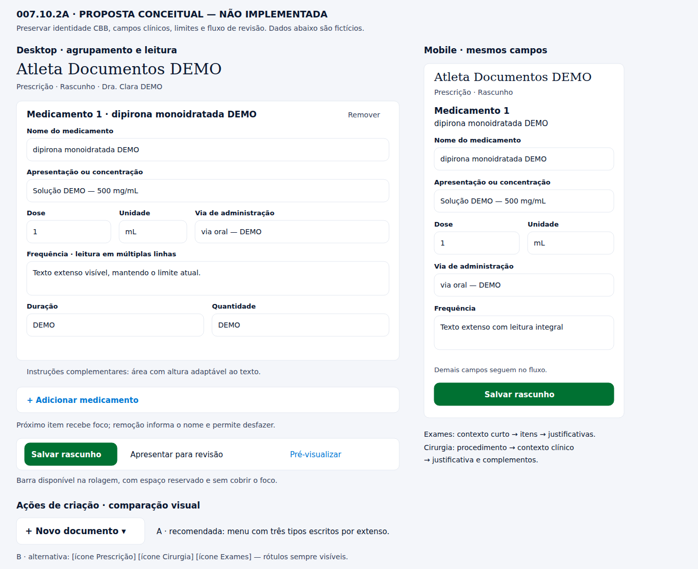

# HANDOFF 007.10.2A — Diagnóstico dos documentos médicos

Data: 18/11/2026. Inspeção e proposta, sem implementação.

## Baseline e método

Repositório WSL: `/home/tomaz/projects/prontuario-cbb`. Inspeção iniciada na branch `fix/baseline-before-007-10-2`, commit `4a581d7`, com workspace limpo. Os commits `20c698b` e `f6608bc`, que preservam respectivamente a implementação longitudinal e o seed de demonstração, são ancestrais dessa baseline. Não foi utilizada a branch antiga `feat/longitudinal-history`.

Executada a aplicação de produção já compilada, em servidor próprio `127.0.0.1:3100`, com Supabase local. Chromium headless, Playwright JS existente, desktop 1440×900 e mobile 390×844; verificação adicional de largura em 320 px. Foram utilizados exclusivamente um atleta, uma médica e sete rascunhos fictícios criados para esta inspeção. Os rascunhos foram criados pela RPC existente; as alterações de inclusão/remoção foram salvas pela interface real. Esses dados temporários foram removidos ao encerrar a inspeção.

Foram consultados AGENTS.md, DESIGN.md, Clinical Design North Star e as skills frontend-design, web-design-guidelines, webapp-testing e karpathy-guidelines. A orientação visual aprovada do projeto prevalece sobre sugestões genéricas de design e capitalização. Referência auxiliar: [Web Interface Guidelines](https://raw.githubusercontent.com/vercel-labs/web-interface-guidelines/main/command.md), sobretudo foco, formulários e conteúdo extenso.

**Conclusão:** os três editores existem, preservam contexto do atleta e permitem reabrir rascunhos. O refinamento deve melhorar leitura, orientação e proteção de trabalho em edição. Não há fundamento para um redesign geral ou para capitalizar automaticamente conteúdo clínico.

## Cobertura e capturas reais

Cada cenário abaixo foi aberto nos dois tamanhos. Os arquivos sem sufixo `inicial` capturam a página inteira; os com esse sufixo mostram apenas a primeira tela. Todos representam a aplicação atual, sem manipulação visual.

| Cenário | Desktop | Mobile |
|---|---|---|
| Prescrição: 1 medicamento | [Captura](../visual/handoff-007-10-2a/prescricao-1-1440.png) | [Captura](../visual/handoff-007-10-2a/prescricao-1-390.png) |
| Prescrição: 3 medicamentos | [Captura](../visual/handoff-007-10-2a/prescricao-3-1440.png) | [Captura](../visual/handoff-007-10-2a/prescricao-3-390.png) |
| Prescrição: 6 medicamentos | [Página inteira](../visual/handoff-007-10-2a/prescricao-6-1440.png) · [Visão inicial](../visual/handoff-007-10-2a/prescricao-6-1440-inicial.png) | [Página inteira](../visual/handoff-007-10-2a/prescricao-6-390.png) · [Visão inicial](../visual/handoff-007-10-2a/prescricao-6-390-inicial.png) |
| Exames: 1 item | [Captura](../visual/handoff-007-10-2a/exames-1-1440.png) | [Captura](../visual/handoff-007-10-2a/exames-1-390.png) |
| Exames: 3 itens | [Captura](../visual/handoff-007-10-2a/exames-3-1440.png) | [Captura](../visual/handoff-007-10-2a/exames-3-390.png) |
| Exames: 6 itens | [Página inteira](../visual/handoff-007-10-2a/exames-6-1440.png) · [Visão inicial](../visual/handoff-007-10-2a/exames-6-1440-inicial.png) | [Página inteira](../visual/handoff-007-10-2a/exames-6-390.png) · [Visão inicial](../visual/handoff-007-10-2a/exames-6-390-inicial.png) |
| Pedido cirúrgico | [Página inteira](../visual/handoff-007-10-2a/cirurgia-1-1440.png) · [Visão inicial](../visual/handoff-007-10-2a/cirurgia-1-1440-inicial.png) | [Página inteira](../visual/handoff-007-10-2a/cirurgia-1-390.png) · [Visão inicial](../visual/handoff-007-10-2a/cirurgia-1-390-inicial.png) |
| Ações de criação no perfil | [Captura](../visual/handoff-007-10-2a/acoes-1440.png) | [Captura](../visual/handoff-007-10-2a/acoes-390.png) |

Foco visível por teclado: [prescrição](../visual/handoff-007-10-2a/prescription-foco-1440.png), [exames](../visual/handoff-007-10-2a/exam_request-foco-1440.png), [cirurgia](../visual/handoff-007-10-2a/surgical_order-foco-1440.png).

Complementos: [prescrição após remover item](../visual/handoff-007-10-2a/prescricao-remocao-390.png), [exames após remover item](../visual/handoff-007-10-2a/exames-remocao-390.png), [prescrição sem itens](../visual/handoff-007-10-2a/prescricao-vazio-1440.png), [exames sem itens](../visual/handoff-007-10-2a/exames-vazio-1440.png), prévias mobile de [prescrição](../visual/handoff-007-10-2a/prescricao-previa-390.png), [exames](../visual/handoff-007-10-2a/exames-previa-390.png) e [cirurgia](../visual/handoff-007-10-2a/cirurgia-previa-390.png).

[Medições e observações do navegador](../visual/handoff-007-10-2a/observacoes.json) registram alturas, conteúdo excedente dos campos, interações, valores retornados pela RPC e erros de execução.

## O que funciona e deve ser preservado

- Identificação do atleta, tipo, estado, médica e credencial permanecem visíveis no cabeçalho. O link de retorno mantém o atleta e a aba de documentos.
- Medicamentos e exames **já possuem** `fieldset`/`legend`, borda e numeração. Não falta agrupamento semântico; falta melhorar reconhecimento rápido com vários itens.
- Dose, unidade, apresentação, via, frequência, duração, quantidade e instruções são campos distintos. Não há mistura observada de valores entre medicamentos.
- Inclusão e remoção atualizaram a lista correta; salvar e reabrir preservou os itens remanescentes e o novo item. Em ambos os editores: três itens → adicionar quarto → remover segundo → salvar → reabrir com primeiro, terceiro e item novo.
- A remoção do último item apresenta mensagem essencial e mantém o botão de adicionar. A estrutura de validação já existe.
- Os controles possuem rótulos, navegação sequencial e foco visual por borda/sombra ou contorno. `outline: none` nos inputs tem substituição por foco visível; não foi tratado como ausência de foco.
- A grade passa de duas colunas para uma no mobile. Nenhuma das 14 páginas medidas apresentou rolagem horizontal; a verificação dos três editores com um item em 320 px também não encontrou excesso horizontal.
- A prévia identifica claramente “RASCUNHO — NÃO ASSINADO / NÃO EMITIDO”. Salvar, apresentar para revisão e pré-visualizar continuam ações distintas.

## Medidas que explicam a dificuldade de uso

Coordenadas aproximadas desde o topo do documento, antes de qualquer rolagem manual. Os textos extensos são sintéticos, dentro dos limites atuais; estas medidas não representam todos os prontuários.

| Editor | Itens | Altura desktop / mobile | Início das ações desktop / mobile |
|---|---:|---:|---:|
| Prescrição | 1 | 1.302 / 1.815 px | 1.210 / 1.627 px |
| Prescrição | 3 | 2.666 / 3.719 px | 2.574 / 3.531 px |
| Prescrição | 6 | 4.712 / 6.575 px | 4.620 / 6.387 px |
| Exames | 1 | 1.715 / 2.134 px | 1.623 / 1.946 px |
| Exames | 3 | 2.945 / 3.538 px | 2.853 / 3.350 px |
| Exames | 6 | 4.789 / 5.644 px | 4.697 / 5.456 px |
| Cirurgia | — | 1.333 / 1.664 px | 1.241 / 1.476 px |

Na solicitação de exames, o primeiro item começa aproximadamente em y=909 no desktop e y=1.120 no mobile: fica além da primeira tela, depois de seis campos gerais. Na prescrição, cada medicamento ocupa aproximadamente 666 px no desktop e 936 px no mobile. A coluna de 46rem deixa espaço à direita no desktop, mas isso também limita o comprimento das linhas; alargá-la indiscriminadamente não é recomendado.

## Achados priorizados

Nenhum P0 de segurança/autorização foi demonstrado nesta inspeção. Isso não equivale a uma auditoria completa de segurança. Há problemas P1 com risco de perda de trabalho e dificuldade de conferência clínica.

### P1-01 — Saída descarta edição sem aviso

**Observado:** editar o nome de medicamento, exame ou procedimento, clicar “Voltar aos documentos” e reabrir restaura o valor salvo anterior, sem diálogo. A navegação foi reproduzida nos três editores. A prévia também é um link para a versão persistida, não uma prévia do estado React em edição; esse comportamento está no código, e não foi confundido com perda na persistência.

**Evidência:** `observacoes.json`, seção `extra.navigation`; [screen.tsx:40](../../src/features/documents/screen.tsx#L40), [editors.tsx:50](../../src/features/documents/editors.tsx#L50), [draft-watch.tsx:8](../../src/features/clinical/draft-watch.tsx#L8). O watcher registra eventos input/change; adicionar/remover por botão não aciona esse registro. A marca de edição é usada no Intelligence, mas não protege esse link de retorno.

**Impacto:** retrabalho e risco de o profissional acreditar que alterações entraram no rascunho ou na prévia. **Proposta:** proteção de saída no editor, incluindo alterações estruturais; tornar explícito quando a prévia representa o último salvamento. Preservar a ação explícita de salvar, sem autosave e sem mexer na confirmação clínica. **Complexidade:** média. **Risco de implementação:** médio, pelas transições entre editor, perfil e prévia. **Componentes:** editores, DraftForm, DocumentScreen e integração existente de estado não salvo.

### P1-02 — Inclusão/remoção quebra continuidade pelo teclado

**Observado:** Enter em “Adicionar” cria o quarto item, mas mantém foco no botão. O próximo Tab vai a “Observações gerais” na prescrição ou “Salvar rascunho” em exames, pulando o item recém-criado. Enter em “Remover … 2” deixa `document.activeElement` no BODY. Os demais campos seguem ordem coerente.

**Evidência:** `observacoes.json`, `interactions`; [editors.tsx:91](../../src/features/documents/editors.tsx#L91), [editors.tsx:215](../../src/features/documents/editors.tsx#L215). **Impacto:** perda de localização e mais navegação para preencher o novo item; mais relevante em listas extensas e com tecnologia assistiva. **Proposta:** foco no nome do novo item; após remoção, foco previsível no item adjacente ou em adicionar; anúncio breve da operação. **Complexidade:** baixa a média. **Risco:** baixo. **Componentes:** PrescriptionEditor e ExamEditor.

### P1-03 — Remoção imediata sem recuperação

**Observado:** botão numerado remove imediatamente, inclusive o único item, sem confirmação ou desfazer. Os itens são renumerados; o nome não aparece na ação de remoção. **Evidência:** capturas de remoção/vazio e mesmos handlers de P1-02. **Impacto:** um clique equivocado elimina o preenchimento local; salvar pode consolidar a exclusão. Nenhuma remoção de documento inteiro foi feita. **Proposta:** oferecer desfazer local e identificar o item pelo nome no contexto/acessibilidade; preservar UUID e campos ao restaurar. Evitar um modal a cada operação rotineira. **Complexidade:** média. **Risco:** médio, pela restauração fiel do estado local. **Componentes:** os dois editores repetíveis.

### P1-04 — Textos extensos exigem rolagem dentro de campos pequenos

**Observado:** frequência é input de uma linha; na amostra, 767 px de conteúdo para 317 px úteis no desktop e 296 px no mobile. As instruções têm 70 px de altura útil para 141/309 px de conteúdo. Justificativas cirúrgicas e de exames têm 93 px para 141/285 px. Textareas permitem redimensionamento vertical, mas exigem iniciativa manual e o recurso é menos evidente no mobile. O conteúdo não foi perdido: fica fora da porção visível.

**Evidência:** capturas dos três editores e `scenarios.fields`; [editors.tsx:86](../../src/features/documents/editors.tsx#L86), [documents.css:7](../../src/features/documents/documents.css#L7). **Impacto:** revisão parcial de posologia, instruções ou justificativas. **Proposta:** campo de frequência com quebra de linha mantendo string/limite; textareas com altura inicial adequada e expansão conforme conteúdo, com limite visual cuidadosamente escolhido. Não alterar limites ou modelo clínico. **Complexidade:** média. **Risco:** médio pela interação entre expansão, rolagem e foco. **Componentes:** campos de texto dos três editores e CSS de documentos.

### P1-05 — Ações globais distantes em documentos extensos

**Observado:** as ações ficam apenas ao final; seis medicamentos levam “Salvar” a y≈6.387 no mobile. **Evidência:** tabela de medidas, capturas completas e [editors.tsx:41](../../src/features/documents/editors.tsx#L41). **Impacto:** deslocamento longo entre conferência e salvamento; estado e ações deixam de acompanhar a edição. **Proposta:** barra de ações disponível durante a rolagem, com espaço reservado, foco desobstruído e comportamento testado com teclado virtual. Manter distinção entre salvar e revisão; acesso à prévia continua dependente do fluxo salvo existente. **Complexidade:** média. **Risco:** médio no mobile. **Componentes:** DraftForm e documents.css.

### P1-06 — Exames aparecem depois de um bloco geral extenso

**Observado:** não se vê sequer o primeiro exame na primeira tela dos dois tamanhos avaliados. A página começa com data, prioridade, indicação, justificativa, hipótese e orientações. **Evidência:** capturas iniciais de exames; [editors.tsx:177](../../src/features/documents/editors.tsx#L177). **Impacto:** demora para reconhecer e editar o objeto principal da solicitação. **Proposta:** data/prioridade compactas, seção “Exames solicitados” em seguida e contexto clínico/justificativas depois, preservando todos os campos e regras. **Complexidade:** baixa a média. **Risco:** baixo a médio pela nova sequência de leitura e Tab. **Componentes:** ExamEditor/CSS.

### P2-01 — Numeração ajuda, mas identifica pouco em listas extensas

**Observado:** legendas são somente “Medicamento 1” e “Exame 1”. Os nomes só estão nos inputs; todas as caixas têm peso semelhante. Já existe separação suficiente para evitar afirmar que os itens estão visualmente misturados. **Evidência:** capturas de seis itens; [editors.tsx:79](../../src/features/documents/editors.tsx#L79). **Impacto:** maior esforço para localizar um item específico e conferir a associação entre nome e posologia. Confusão clínica é um risco de usabilidade, não um erro de associação observado. **Proposta:** cabeçalho com número + nome digitado, sem alterar sua grafia, e grupos visuais de identificação, administração e complementos. Nenhum acordeão obrigatório na primeira etapa. **Complexidade:** baixa. **Risco:** baixo. **Componentes:** PrescriptionEditor/ExamEditor/CSS.

### P2-02 — Mesmo peso visual para rótulos e conteúdo

**Observado:** labels têm peso 600; inputs/textareas herdam `font: inherit`, resultando em muitos valores com o mesmo destaque dos rótulos. Cirurgia é uma sequência contínua, com pouca diferenciação entre procedimento, justificativa e complementos. **Evidência:** capturas iniciais; [documents.css:6](../../src/features/documents/documents.css#L6), [globals.css:67](../../src/app/globals.css#L67). **Impacto:** leitura pesada e menor hierarquia. **Proposta:** conteúdo operacional regular, rótulos semibold e títulos de seção em 17px/600; preservar nome do atleta em Geist Serif e restante em Geist Sans. Na cirurgia, seções discretas sem novos painéis decorativos. **Complexidade:** baixa. **Risco:** baixo. **Componentes:** CSS restrito a documentos e SurgicalEditor.

### P2-03 — Três ações extensas competem com o início da lista

**Observado:** os três botões funcionam e têm nomes explícitos; no mobile ocupam três linhas. Não são ações ausentes ou inacessíveis. **Evidência:** capturas de ações e [page.tsx:184](<../../src/app/(workspace)/atletas/[id]/page.tsx#L184>). **Impacto:** mais altura e repetição visual antes dos filtros e documentos. **Proposta:** alternativa A, comparada abaixo. **Complexidade:** baixa a média. **Risco:** baixo a médio pelo gerenciamento do menu e foco. **Componentes:** cabeçalho da seção Documentos médicos; componente de menu existente, se adequado.

## Origem da capitalização

Não foi encontrada uma regra global que transforme os nomes clínicos em Title Case, caixa alta ou baixa. As diferenças vistas nos exemplos controlados refletem o texto de origem. Isso não permite atribuir retrospectivamente a uma IA uma grafia de documento antigo sem examinar a proposta original correspondente.

| Origem/camada | Evidência inspecionada | Diagnóstico e conduta proposta |
|---|---|---|
| Texto preparado pela IA | `agent.ts:537–610, 915–930`; `document-draft.ts:34–121, 249–278` | As ferramentas recebem strings e os builders aplicam trim/limites, sem capitalização geral. Os prompts restringem invenção clínica, mas não estabelecem uma regra de caixa. A IA pode fornecer grafia variável; isso é possibilidade do ponto de entrada, não causa comprovada de um documento histórico. Não foi feita chamada ao modelo nesta auditoria. |
| Backend/RPC | `20261116000100_clinical_documents.sql:42–50`; definição atual em `20261117000100_exam_request.sql:7–100` | `clip_text` remove espaços externos e valida comprimento. `lower` normaliza UUIDs, não nomes. O conteúdo retornado por `document_open` manteve a caixa dos exemplos. Sem correção proposta no banco. |
| Dados salvos pelo usuário | `editors.tsx:81–89, 122–134, 195–212`; interações gravadas | `onChange` preserva texto digitado. O item `ITEM TEMPORÁRIO DEMO` continuou assim depois de salvar/reabrir. Manter essa propriedade. |
| Transformação visual | `documents.css`; estilos computados em `observacoes.json` | Inputs e textareas medidos têm `text-transform: none`. A prévia usa o texto recebido e trim para nomes. Não há evidência de caixa forçada pelo CSS dos editores. |
| Rótulos e sugestões fixas | `content.ts:58–99` | Títulos/rótulos usam caixa de frase; sugestões como “Hemograma completo” já têm inicial maiúscula no catálogo local. Selecionar sugestão fornece essa grafia. Trata-se de conteúdo fixo, não de transformação do nome digitado. |
| Comparações internas | `editors.tsx:170`; `document-draft.ts:220–243, 282–290` | Lowercase serve para reconhecer sugestão, enums e duplicatas. O valor de nome armazenado não é substituído pela versão em lowercase. Não remover essas comparações como suposta correção visual. |

Verificações: `dipirona monoidratada DEMO`, `DIPIRONA DEMO`, `vitamina B12 DEMO`, `HbA1c DEMO`, `RM de joelho DEMO`, `β-hCG DEMO`, `mL`, `500 mg/mL` e `artroscopia de joelho — LCA DEMO` aparecem nos dados/capturas. Os nomes de todos os cenários foram comparados com o retorno da RPC; a prévia de um item por tipo também foi capturada. As diferenças de caixa foram preservadas.

**Recomendação:** não incluir capitalização automática no 007.10.2B. Ajustar somente rótulos fixos cuja redação venha a ser aprovada. Um futuro caso concreto deve comparar entrada do profissional → proposta estruturada → JSON salvo → editor/prévia antes de propor correção. Proteger siglas, nomes científicos, unidades, abreviações e grafias específicas; não regravar documentos para uniformizar aparência.

## Ações de criação: A versus B

| Critério | A — “Novo documento” + menu | B — três ações compactas com ícones e rótulos |
|---|---|---|
| Eficiência | Duas ativações até escolher o tipo | Uma ativação por tipo |
| Clareza | Entrada única clara; tipos ficam visíveis ao abrir | Tipos sempre visíveis; rótulos curtos precisam permanecer inequívocos |
| Espaço | Uma ação no desktop/mobile | Menor que os textos atuais no desktop, mas três alvos continuam disputando espaço no mobile |
| Acessibilidade | Exige estado expandido, teclado, Escape e retorno de foco; itens como links para as rotas atuais | Exige rótulos visíveis, nomes acessíveis completos e tooltips acessíveis por foco; tooltip não substitui rótulo |
| North Star | Reduz competição entre ações equivalentes e mantém superfície editorial limpa | Favorece atalhos frequentes, mas cria uma pequena barra de ferramentas na seção |
| Evolução | Acomoda futuros tipos sem multiplicar botões | Cresce horizontal/verticalmente a cada tipo |

**Recomendada: A.** A economia de espaço é particularmente útil na evidência mobile; a escolha do tipo acrescenta uma ativação previsível. Menu com “Prescrição”, “Pedido cirúrgico” e “Solicitação de exames”, escritos por extenso. “Novo documento” cria um rascunho, nunca comunica emissão. Preservar exatamente as condições atuais de autorização e os destinos dos links. Não introduzir botão híbrido nem outra ação adicional nesta etapa. A opção B continua válida se testes com profissionais demonstrarem que o custo da segunda ativação é relevante; não há dados de frequência de uso nesta auditoria que comprovem isso.

## Proposta visual pontual

[Arquivo vetorial da proposta](../visual/handoff-007-10-2a/proposta-conceitual.svg). Este desenho é um esquema de composição, não uma captura da aplicação nem especificação final de todos os campos. A tipografia do desenho usa fallback; a implementação futura deve usar os arquivos Geist existentes.

Preservar canvas `#f4f6fa`, superfície branca, fios `#e4e9f1`, tinta `#0a1731`, azul de foco/link `#0079d5` e ação principal verde `#007132`. Manter coluna de leitura e alinhamento à esquerda; não preencher espaço vazio com novos cards.

Prescrição: item identificado por número e nome; nome/apresentação antes de administração; dose e unidade próximas; via, frequência, duração e quantidade claramente associadas ao mesmo item; instruções com leitura ampliada. Exames: contexto operacional breve, itens e depois justificativas gerais. Cirurgia: procedimento/região/lateralidade, contexto clínico e justificativa/complementos, com separação editorial discreta. Em todos os casos, os campos atuais permanecem.

No mobile, empilhar campos longos e manter dose/unidade lado a lado somente se couberem sem reduzir os alvos. Considerar cabeçalho do item identificável durante leitura longa, sem sobrepor conteúdo; não adotar múltiplas barras fixas antes de testar teclado virtual e zoom. A barra de ações ilustrada depende dessa validação.

**Reuso suficiente:** estilo de seção repetível, cabeçalho do item, controles adicionar/remover/desfazer, tratamento de foco e barra de ações. Os formulários de medicamento e exame continuam específicos. Não criar schema universal de campos, componente clínico configurável ou unificação da persistência.

## Escopo recomendado — 007.10.2B

1. Corrigir orientação de foco e anúncio de inclusão/remoção; oferecer recuperação da remoção local e registrar essas mudanças como edição não salva.
2. Proteger saída com alterações pendentes e esclarecer a relação entre salvamento e prévia, usando os contratos existentes.
3. Melhorar leitura de frequência, instruções e justificativas extensas, preservando strings, limites e payloads.
4. Aproximar ações globais da área de trabalho, validar comportamento em mobile e manter as mesmas ações/estados.
5. Reorganizar visualmente exames; reforçar identificação dos itens e hierarquia tipográfica nos três editores.
6. Substituir as ações de criação pelo menu A, após aprovação deste escopo.

Complexidade global **média**, concentrada no frontend. Maior risco: foco, recuperação do estado local, proteção de navegação e barra de ações com teclado virtual. Backend, banco, RPCs, autorização, auditoria, agente, confirmação, assinatura/emissão e estruturas clínicas ficam fora do escopo. Capitalização automática e redesign do perfil também ficam fora.

Aceite sugerido: repetir 1/3/6 itens, textos próximos dos limites, adicionar/remover/desfazer inclusive último item, salvar/reabrir, sair com edições pendentes e abrir prévia; validar teclado completo, foco, leitor de tela e mobile com teclado real. Comparar payloads antes/depois e confirmar preservação de `HbA1c`, `β-hCG`, `mL`, `mg/mL`, `RM` e `LCA`. Executar os testes de documentos, exames e autorização existentes, a suíte completa, lint, typecheck e build após a implementação futura.

## Limites e fechamento

Esta é uma inspeção funcional/visual em Chromium com viewport mobile emulado. Não foram executados VoiceOver/TalkBack, Safari/iOS, teclado virtual de dispositivo real, ensaio com médicos, benchmark de uso ou nova auditoria de autorização entre perfis. Não foi provocada emissão/assinatura ou alterado qualquer fluxo clínico. Os achados de acessibilidade são de código e teclado observado, sem certificação WCAG.

O navegador não registrou `pageerror` nos cenários principais. Não foram repetidos lint/typecheck/build/suíte integral neste handoff documental: nenhum arquivo de aplicação ou teste foi alterado. A aprovação desses checks pertence ao fechamento anterior da baseline; não representa nova execução nesta auditoria.

Entrega limitada a este relatório, capturas, esquema visual e observações. Sem implementação, merge ou publicação. Os arquivos de produção permanecem idênticos a `4a581d7`.

Os artefatos foram organizados na branch documental `docs/handoff-007-10-2a-medical-documents-audit`, criada diretamente da baseline. A branch `fix/baseline-before-007-10-2` continua em `4a581d7`; nenhuma branch de implementação foi integrada.
