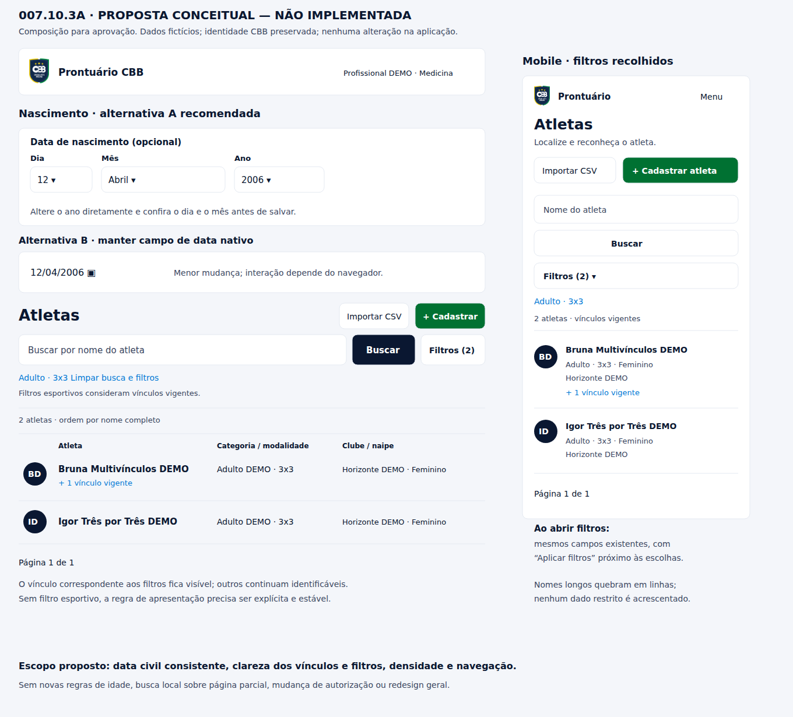

# HANDOFF 007.10.3A — Auditoria do cadastro e da listagem de atletas

18/11/2026. Inspeção e proposta visual, sem implementação, merge ou publicação.

## Baseline, isolamento e método

Repositório: `/home/tomaz/projects/prontuario-cbb`. Início com workspace limpo em `c5c0154`, contendo o refinamento 007.10.2B (`269b8f6`) e a correção posterior do menu e da edição por item. Branch documental: `docs/handoff-007-10-3a-athlete-directory-audit`, criada diretamente desse estado. As entregas anteriores foram preservadas; não se partiu de uma branch antiga.

Para não escrever no banco da demo, foi criada uma instância local descartável independente, `prontuario-cbb-ux-103a`, com API na porta 55321 e banco na 55322. Ela foi inicializada com as migrações existentes, sem editar suas definições. A aplicação foi compilada em cópia temporária do mesmo commit e executada na porta 3200. O build da cópia usou webpack para trabalhar com as dependências já instaladas, sem instalação de bibliotecas. O código da aplicação inspecionada é o do commit acima; não houve substituição por mock de tela/RPC.

Os testes de cadastro e escala escreveram exclusivamente nessa instância separada. Foram usados três profissionais e atletas fictícios. O conjunto principal cresceu de 0 para 1, 10, 50 e 3.000 atletas autorizados. Os cenários de datas usaram outro profissional, evitando contaminar essas contagens. Sete vínculos esportivos cobrem casos vigentes, múltiplos e encerrados; a foto é a imagem fictícia já existente no design lab, usada somente na instância descartável.

Capturas e verificações ocorreram em Chromium 159, desktop 1440×900 e viewports de 390×844 e 320×844, com localidade pt-BR e fuso America/Sao_Paulo. O calendário também foi capturado em Chromium com interface, cuja janela de teste foi encerrada. As verificações posteriores e a proposta foram produzidas em segundo plano, sem abrir novas janelas. Não foi automatizado o navegador pessoal do usuário.

Foram consultados o [Clinical Design North Star](../design-lab/clinical-north-star.md), DESIGN.md e os padrões do projeto. Referências auxiliares: [MDN — input date](https://developer.mozilla.org/en-US/docs/Web/HTML/Reference/Elements/input/date) e [Web Interface Guidelines](https://raw.githubusercontent.com/vercel-labs/web-interface-guidelines/main/command.md). A direção visual CBB prevalece sobre recomendações genéricas.

## Diagnóstico principal

A busca e a paginação já operam sobre todo o conjunto autorizado no banco, e não somente sobre os primeiros atletas exibidos. O calendário permite digitar o ano diretamente; não há evidência para declarar essa funcionalidade ausente. As datas válidas testadas mantiveram seu valor civil após salvar e reabrir.

Os principais problemas são de **representação do contexto esportivo**, **aplicação/visibilidade dos filtros no mobile**, **distinção de estados vazios** e **inconsistência da validação visual entre cadastro e edição**. A base visual de linhas compactas, identidade CBB e tipografia operacional deve continuar.

## Capturas reais

| Evidência solicitada | Capturas |
|---|---|
| Nascimento no cadastro principal em modal | [Desktop](../visual/handoff-007-10-3a/cadastro-modal-1440.png) · [390px](../visual/handoff-007-10-3a/cadastro-modal-390.png) · [320px](../visual/handoff-007-10-3a/cadastro-modal-320.png) |
| Cadastro na página própria | [Desktop](../visual/handoff-007-10-3a/cadastro-nascimento-1440.png) · [390px](../visual/handoff-007-10-3a/cadastro-nascimento-390.png) |
| Calendário aberto | [Captura em segundo plano](../visual/handoff-007-10-3a/calendario-segundo-plano.png) · [Calendário nativo em pt-BR](../visual/handoff-007-10-3a/calendario-nativo-1440.png) |
| Edição de nascimento existente | [Edição](../visual/handoff-007-10-3a/edicao-nascimento-1440.png) · [Bissexto salvo/reaberto](../visual/handoff-007-10-3a/edicao-bissexto-1440.png) |
| Validação e teclado | [Digitação](../visual/handoff-007-10-3a/nascimento-digitacao-1440.png) · [Data inválida](../visual/handoff-007-10-3a/data-invalida-teclado.png) · [Futura rejeitada na edição](../visual/handoff-007-10-3a/edicao-futura-rejeitada-1440.png) |
| Nenhum atleta | [Desktop](../visual/handoff-007-10-3a/lista-0-1440.png) · [390px](../visual/handoff-007-10-3a/lista-0-390.png) · [320px](../visual/handoff-007-10-3a/lista-0-320.png) |
| Um atleta | [Desktop](../visual/handoff-007-10-3a/lista-1-1440.png) · [390px](../visual/handoff-007-10-3a/lista-1-390.png) · [320px](../visual/handoff-007-10-3a/lista-1-320.png) |
| Dez atletas e variações cadastrais | [Desktop](../visual/handoff-007-10-3a/lista-10-1440.png) · [390px](../visual/handoff-007-10-3a/lista-10-390.png) · [320px](../visual/handoff-007-10-3a/lista-10-320.png) |
| Cinquenta atletas | [Desktop](../visual/handoff-007-10-3a/lista-50-1440.png) · [390px](../visual/handoff-007-10-3a/lista-50-390.png) · [320px](../visual/handoff-007-10-3a/lista-50-320.png) |
| 3.000 atletas | [Desktop](../visual/handoff-007-10-3a/lista-3000-1440.png) · [390px](../visual/handoff-007-10-3a/lista-3000-390.png) · [320px](../visual/handoff-007-10-3a/lista-3000-320.png) |
| Filtros abertos | [Desktop](../visual/handoff-007-10-3a/filtros-abertos-1440.png) · [390px](../visual/handoff-007-10-3a/filtros-abertos-390.png) · [320px](../visual/handoff-007-10-3a/filtros-abertos-320.png) |
| Filtros combinados | [Desktop](../visual/handoff-007-10-3a/filtros-combinados-1440.png) · [390px](../visual/handoff-007-10-3a/filtros-combinados-390.png) |
| Sem resultados | [Busca](../visual/handoff-007-10-3a/sem-resultados-1440.png) · [Mobile](../visual/handoff-007-10-3a/sem-resultados-390.png) · [Combinação sem correspondência](../visual/handoff-007-10-3a/combinacao-sem-resultados-1440.png) |
| Paginação | [Segunda página](../visual/handoff-007-10-3a/paginacao-segunda-pagina.png) · [Página fora do intervalo](../visual/handoff-007-10-3a/pagina-fora-limite-1440.png) |
| Resultado → perfil → retorno | [Perfil](../visual/handoff-007-10-3a/resultado-perfil-1440.png) · [Filtros recuperados](../visual/handoff-007-10-3a/retorno-filtros-1440.png) |
| Casos específicos | [Vínculo encerrado](../visual/handoff-007-10-3a/vinculo-encerrado-1440.png) · [Nome social](../visual/handoff-007-10-3a/nome-social-1440.png) · [Acesso limitado](../visual/handoff-007-10-3a/listagem-acesso-limitado-1440.png) |

[Observações estruturadas, valores, medições e resultados](../visual/handoff-007-10-3a/observacoes.json). As capturas acima são da aplicação real; a proposta mais adiante é ilustrativa e está identificada separadamente.

## Nascimento: funcionamento verificado

Componente atual: `<input type="date">`, reutilizado no cadastro em modal e na página própria. A edição do perfil também utiliza input nativo, em outra composição.

| Caso | Resultado observado |
|---|---|
| 12/04/1990 | Salvo e reaberto como `1990-04-12` |
| 12/04/2006 | Salvo e reaberto como `2006-04-12` |
| 12/04/2012 | Salvo e reaberto como `2012-04-12` |
| 12/04/2018 | Salvo e reaberto como `2018-04-12` |
| Recente válida: 17/11/2026 | Salva e reaberta sem deslocamento |
| 29/02/2024 | Aceita e preservada |
| Campo vazio | Permitido no cadastro; persistência nula, reabertura vazia |
| Editar 1990 para 29/02/2012 | Salvo/reaberto como `2012-02-29` |
| 29/02/2023 digitado no segmento de dia | Valor civil vazio, `badInput=true`; navegador impediu submissão da data inválida |
| Payload `2023-02-29` enviado à RPC | Rejeitado com `invalid`, campo `birth` |
| Data futura 19/11/2026 no cadastro | `rangeOverflow=true`; RPC também rejeitou |
| 31/12/1899 | Cadastro e RPC rejeitaram pelo limite existente |
| Futura na edição do perfil | Campo HTML considerou válida; salvamento rejeitado e data anterior preservada |

**Ano, mês e dia por teclado:** foi digitado diretamente `1990-04-12`; no segmento de ano, seta para cima produziu `1991-04-12`; no mês, `1991-05-12`; no dia, `1991-05-11`. Portanto, é possível escolher o ano sem percorrer centenas de meses. O popup observado possui cabeçalho mês/ano, setas e grade de dias. Não se conclui que outro navegador ou SO careça de seletor rápido de ano.

A formatação visual depende do ambiente do navegador. Houve controle em `dd/mm/aaaa` com mês em português e também textos nativos em inglês em execução sem interface. `lang="pt-BR"` e `navigator.language` não tornam todos os widgets do navegador idênticos. Isso não deve ser confundido com uma string fixa da aplicação. A [documentação do input date](https://developer.mozilla.org/en-US/docs/Web/HTML/Reference/Elements/input/date) distingue a apresentação regional do valor normalizado `yyyy-mm-dd`.

A regra identificada é **1900 até hoje**, com campo opcional; não foi criada nem presumida idade mínima de atleta. Datas de 2018 e recentes são aceitas pelas regras atuais. `athlete_register` verifica “hoje” em America/Sao_Paulo, enquanto o atributo `max` do cadastro usa `toISOString()` (UTC) e a constraint da tabela usa `current_date`. No exemplo calculado, `2026-11-19T00:30:00Z` corresponde a 18/11 em São Paulo, mas gera máximo HTML 19/11. É uma divergência de fórmulas identificada em código, não uma falha temporal provocada no servidor durante a auditoria.

Nos casos persistidos, a string civil foi mantida sem alteração de dia. A apresentação do cadastro usa fuso explícito e horário intermediário para formatar a data; não foi observado deslocamento. A proposta não autoriza migrar datas nem convertê-las para timestamp.

## Listagem, busca e filtros: contrato real

| Recurso | Suporte atual e local de execução |
|---|---|
| Nome completo, parcial e social | Busca na RPC `athlete_directory`, sobre todos os atletas autorizados. Nome completo extenso e fragmentos foram encontrados. |
| Acentos e caixa | `érica` e `erica` retornaram a mesma atleta; normalização ocorre no banco. |
| Categoria | Filtro na RPC sobre vínculo vigente; comparação normalizada. |
| Clube/equipe | Filtro na RPC sobre vínculo vigente, com a função de correspondência textual já existente. Não é um filtro por posição na lista nem por identidade de gênero. |
| Naipe | `division` do vínculo esportivo, na RPC. É distinto de `gender_identity`, atributo pessoal restrito. |
| Modalidade | Filtro na RPC; fixtures de 5x5 e 3x3. |
| Status | Ativo/inativo/todos na RPC. O encerramento de um vínculo não altera por si o status do atleta. |
| Combinação | Categoria/naipe/modalidade/clube devem corresponder ao **mesmo vínculo vigente**. Status aplica-se ao atleta. |
| Histórico | Não há filtro de vínculos encerrados na listagem atual. Eles aparecem no histórico do perfil, conforme acesso. Não propor inclusão silenciosa em filtros vigentes. |
| Ordenação | Fixa no banco: `full_name`, depois UUID. Não existe escolha de ordenação na interface. Não há ordenação global por nome social ou atualização. |
| Paginação | RPC calcula total e aplica limite/offset; tela apresenta 25 por página. Não existe escolha de tamanho da página na UI. |
| Aplicar filtros | Formulário GET. Alterar select não executa a consulta imediatamente; é necessário usar “Buscar”, acima dos filtros. |
| Limpar | “Limpar filtros” aponta à rota sem parâmetros e também remove a busca textual. Só aparece quando há filtro ativo além do texto. |
| Retorno do perfil | `retorno` preserva busca, filtros e página; volta ao diretório com os critérios. Verificado no navegador, aguardando a navegação concluir. |

A RPC também tem correspondência para identificadores previstos no domínio, conforme código; isso não representa novos filtros expostos na tela. O marcador de documento pessoal restrito da fixture não foi encontrado pela busca.

**Camada de apresentação:** `AthleteCatalog` é um componente de servidor Next. Ele normaliza/limita parâmetros, monta URLs, deduplica/ordena opções recebidas e apresenta os fatos esportivos. Não filtra os atletas apenas no navegador. As opções dos selects vêm de todos os vínculos vigentes autorizados, independentemente dos 25 atletas da página; não são opções deduzidas somente da página visível. Elas também não são filtros dependentes entre si.

### Múltiplos vínculos: evidência decisiva

Bruna possui dois vínculos vigentes: Sub-17/5x5/Aurora e Adulto/3x3/Horizonte. A combinação Adulto + 3x3 + Feminino + Horizonte retorna Bruna e Igor, corretamente, sem duplicar Bruna. Entretanto, a linha de Bruna mostra **Sub-17, 5x5, Aurora**, pois a tela usa o primeiro elemento de `sports`.

Sub-17 + 3x3 retorna zero: esses atributos pertencem a vínculos diferentes de Bruna. Sub-15 e Clube Antigo também retornam zero porque os vínculos correspondentes terminaram em 2025. Essas respostas são a semântica atual, não defeitos de filtragem a serem “corrigidos” com OR entre vínculos.

Davi tem somente vínculo encerrado, mas a linha utiliza `category/team` legados quando `sports` vigente está vazio. A tela não identifica a diferença entre dado legado e vínculo vigente. Não se pode assumir uma vigência ou data a partir desses textos legados.

### Escala e navegação

| Autorizados | Linhas na página | Páginas |
|---:|---:|---:|
| 0 | 0 | 1 vazia |
| 1 | 1 | 1 |
| 10 | 10 | 1 |
| 50 | 25 | 2 |
| 3.000 | 25 | 120 |

A busca “Escala 3000” encontrou o registro fora da primeira página. Páginas 2 e 120 retornaram 25 atletas cada; o clique real em “Próxima” abriu a página 2. Não foi recomendada busca/ordenação local sobre página parcial.

Cinco chamadas locais aquecidas, sem filtros, ficaram em 20–25ms (mediana 20ms). Amostras de busca nominal ficaram aproximadamente em 118–131ms. Esses números não incluem renderização completa, não medem concorrência e não são SLA. O conjunto tem 3.000 atletas, mas somente sete vínculos de exemplo e uma foto; não representa um histórico esportivo denso de produção. Não foi demonstrada necessidade de nova arquitetura de busca.

## Achados e recomendações

Nenhum P0 de autorização foi demonstrado. A inspeção de três perfis não equivale a uma certificação de segurança.

### P1-01 — Linha mostra outro vínculo que não corresponde ao filtro

**Problema/evidência:** cenário Bruna, captura de filtros combinados e `catalog.tsx:14–19`, que escolhe `sports[0]`. A agregação dos vínculos na RPC não define um vínculo principal.

**Impacto:** o profissional pode interpretar um resultado correto como erro da busca ou reconhecer o atleta no contexto esportivo errado. **Solução:** dar visibilidade ao vínculo correspondente aos critérios e indicar outros vínculos vigentes, usando apenas dados já autorizados. Definir explicitamente uma regra estável de apresentação quando não houver filtro; não transformar o primeiro elemento em “vínculo principal” por suposição. **Complexidade:** média. **Risco:** médio, pela interpretação de categoria/equipe/modalidade. **Componentes:** `catalog.tsx`, `AthleteSummary.sports`, apresentação das linhas; contratos da RPC preservados.

### P1-02 — Vigência dos filtros e dos dados legados fica ambígua

**Problema/evidência:** filtros históricos retornam zero, enquanto o exemplo Davi exibe Sub-15/Clube Antigo por fallback legado. O texto “Filtros” não explica vigência ou combinação no mesmo vínculo.

**Impacto:** expectativa de encontrar participações históricas e de combinar categorias de vínculos distintos; erro aparente onde o banco opera corretamente. **Solução:** explicar que os critérios esportivos pertencem ao mesmo vínculo vigente; distinguir dados legados de vínculo vigente com linguagem neutra. Não atribuir datas aos legados e não incluir histórico na consulta sem decisão de produto separada. **Complexidade:** média. **Risco:** médio. **Componentes:** `sportFacts`, bloco de filtros, resumo esportivo da linha.

### P1-03 — Cadastro e edição têm validação visual divergente para nascimento

**Problema/evidência:** `registration-form.tsx:236` define mínimo/máximo; `profile-registration.tsx:239–245` não os define. A edição futura passou pela validade HTML, recebeu mensagem genérica de falha e manteve a data anterior. Há ainda as fórmulas divergentes de “hoje” em UTC/SP.

**Impacto:** envio desnecessário, falta de indicação do campo a corrigir e dúvida entre erro de data e de permissão. **Solução:** compartilhar a interação/validação de nascimento e apresentar erro no campo. Antes de padronizar o máximo, confirmar a regra civil de “hoje” já usada pelo domínio; não reescrever a regra de servidor nem presumir idade mínima. Manter vazio permitido e `YYYY-MM-DD` na fronteira persistida. **Complexidade:** média. **Risco:** médio, incluindo bissextos e fronteiras de dia. **Componentes:** cadastro, edição cadastral e apresentação das mensagens; nenhuma mudança de RPC proposta neste handoff.

### P1-04 — Filtros ativos ocupam a primeira tela no mobile e a aplicação fica distante

**Problema/evidência:** os filtros abrem automaticamente quando ativos (`catalog.tsx:92`). Em 320px, o primeiro resultado começou aproximadamente em y=1.002 e os filtros ocuparam 434px. Em 390px, o primeiro resultado começou em y=755. O único botão de aplicação fica acima dos selects.

**Impacto:** dificuldade para conferir resultados e para perceber que mudar um select ainda não aplicou os critérios. **Solução:** reutilizar o disclosure atual, com contagem/resumo claros e apresentação recolhida no mobile após aplicação; colocar “Aplicar filtros” junto das escolhas, submetendo o mesmo GET. Manter o estado aplicado visível e a navegação por teclado. Não introduzir autoaplicação nem filtro local de página. **Complexidade:** baixa a média. **Risco:** baixo a médio, pelos estados e foco. **Componentes:** formulário/disclosure de `AthleteCatalog`, estilos específicos do diretório.

### P1-05 — Estados vazios confundem ausência de acesso, filtro sem correspondência e página inválida

**Problema/evidência:** uma combinação sem resultado e sem texto de busca mostra “Nenhum atleta disponível para este perfil”. A página 999 mostra vazio e “Página 999 de 120”, apesar de 3.000 atletas autorizados. O componente escolhe a mensagem principalmente pela presença de `q`.

**Impacto:** impressão de perda de acesso e navegação pouco recuperável. **Solução:** separar vazio inicial, ausência de correspondência e página fora do intervalo. Oferecer recuperação para página válida preservando critérios; manter contagens dentro do escopo autorizado. **Complexidade:** baixa a média. **Risco:** baixo. **Componentes:** ramo de estado vazio, URLs e navegação de paginação em `catalog.tsx`.

### P2-01 — A interação de nascimento é pouco explícita e varia entre ambientes

**Problema/evidência:** a entrada direta de ano existe e funciona, mas depende da descoberta dos segmentos do input e dos controles do navegador. Capturas de calendário e digitação mostram a variação regional. Não se declara seletor de ano ausente.

**Impacto:** esforço variável ao cadastrar anos distantes; possível dúvida sobre dia/mês. Não foi medido tempo de execução com profissionais. **Solução:** aprovar uma das duas alternativas comparadas abaixo. **Complexidade:** baixa para manter o nativo; média para três seletores. **Risco:** baixo/médio, respectivamente. **Componentes:** campo de nascimento compartilhado entre cadastro e edição.

### P2-02 — Nomes longos e espaçamento reduzem a densidade no mobile

**Problema/evidência:** a primeira linha com nome longo e fatos esportivos atingiu cerca de 151px em 390px e 199px em 320px. A lista não teve overflow horizontal; a perda é de largura útil para o texto.

**Impacto:** mais rolagem para reconhecer atletas. **Solução:** reduzir margens laterais internas e ajustar avatar/espaçamentos em telas pequenas, mantendo quebra de linha e nome legível. Estabilizar colunas no desktop; não criar cards grandes nem esconder o nome completo indiscriminadamente. **Complexidade:** baixa. **Risco:** baixo. **Componentes:** `.athlete-list`, `.athlete-row-main`, `.directory-facts`, avatar no diretório.

### P2-03 — Ordenação por nome completo não é explícita quando o nome social é principal

**Problema/evidência:** Aline Nome Social aparece conforme a posição de Zuleica Nome Civil. A RPC ordena por `full_name,id`, e não pelo nome mostrado em destaque.

**Impacto:** sequência parece fora de ordem alfabética. **Solução:** identificar a ordenação existente. Se produto desejar outra ordenação, ela precisa operar no conjunto inteiro no servidor, em escopo separado; não ordenar apenas os 25 resultados no frontend. Preservar o respeito ao nome social. **Complexidade:** baixa para explicitar; alteração global de ordem exige decisão adicional. **Risco:** baixo para texto. **Componentes:** contagem/cabeçalho da lista; RPC apenas como referência do contrato vigente.

### Outros refinamentos P2

| Problema e evidência | Impacto e recomendação | Complexidade / risco / componentes |
|---|---|---|
| “Limpar filtros” também remove `q`; ver URL antes/depois em `observacoes.json` e `catalog.tsx:107`. | Usar “Limpar busca e filtros”, refletindo a operação atual. Não mudar silenciosamente o que é limpo. | Baixa / baixo / link e resumo de critérios. |
| UUID interno em `.record-id.sr-only` integra a leitura do conteúdo da linha, embora não seja identificação útil para reconhecimento. | Evitar leitura rotineira desse identificador técnico; preservar destino seguro do link. Não é um vazamento de atributo restrito demonstrado. | Baixa / baixo / texto auxiliar da linha. Avaliação de código, sem ensaio com leitor de tela. |

## Segurança e acessibilidade observadas

O profissional de acesso limitado recebeu exatamente uma atleta, com opções dos vínculos autorizados dessa atleta. O payload da listagem não incluiu documento pessoal ou identidade de gênero; o marcador restrito não foi localizado pela busca. A RPC de cadastro restrito devolveu `null` ao leitor sem edição. Perfil de atleta sem vínculo apresentou a mensagem genérica de página indisponível; foto de atleta sem vínculo retornou 404.

A listagem usa o naipe competitivo do vínculo e não a identidade de gênero. A proposta não acrescenta contatos, documentos pessoais, dados assistenciais ou outro metadado restrito. Foto e iniciais já existem; imagem com `alt=""` é decorativa ao lado do nome identificador, não uma falha presumida de alt.

Cadastrar/Importar seguem a capacidade de criação. A ação de gerenciamento de acesso existe condicionalmente para o perfil operacional; não foi homologado todo o fluxo de gestão neste diagnóstico. O link do perfil para o CBB Intelligence manteve o UUID correto do atleta autorizado. Nenhuma chamada ao modelo ou modificação da integração foi necessária.

Foram feitas seis varreduras axe no conteúdo principal de cadastro/listagem, nos três tamanhos: zero violações/incompletos nas regras WCAG 2 A/AA e 2.1 AA selecionadas. Foco e teclado foram inspecionados; isso não equivale a certificação WCAG nem substitui VoiceOver/TalkBack. Os controles e o foco já existentes devem ser preservados.

## Proposta visual — não implementada

[Arquivo vetorial](../visual/handoff-007-10-3a/proposta-conceitual.svg). O desenho não é uma tela implementada nem captura da aplicação. Usa fallback tipográfico apenas na ilustração; a futura implementação deve reutilizar Geist e os tokens atuais.

### Nascimento: duas alternativas

| Critério | A — Dia / mês / ano com seletores nativos | B — Manter input date e orientar o uso |
|---|---|---|
| Ano distante | Ano explícito, com seleção direta e teclado | Digitação direta já existe; popup varia por navegador |
| Português brasileiro | Rótulos e nomes dos meses controlados pela aplicação | Parte da apresentação pertence ao navegador/SO |
| Simplicidade | Três controles, sem biblioteca de calendário | Menor alteração e menos controles |
| Entrada vazia | Todos vazios representam ausência; entrada parcial precisa de orientação | Comportamento nativo, já opcional |
| Datas reais | Validar composição, bissexto e limites antes de montar a string civil | Preservar validação nativa e alinhar apresentação cadastro/edição |
| Persistência | Converter apenas para a mesma string `YYYY-MM-DD`; sem timestamp | Mesmo contrato atual |

**Recomendação para aprovação: A**, pela visibilidade de ano/mês/dia em uma tarefa de nascimento e pela consistência regional. Não se justifica instalar uma biblioteca de calendário. A alternativa B continua válida se a prioridade for a menor intervenção e se a interação nativa atender à homologação com profissionais. A escolha depende de aprovação; nenhuma das alternativas foi integrada à aplicação.

No desktop, manter linhas editoriais compactas, nome/avatar reconhecíveis e fatos esportivos alinhados. O exemplo da proposta usa o vínculo Adulto/3x3 correspondente aos filtros e identifica a existência de outro vínculo. A regra de destaque sem filtros precisa ser aprovada, sem inventar um vínculo principal.

No mobile, preservar busca, Importar CSV e Cadastrar atleta; recolher filtros sem esconder os critérios aplicados, aproximar a aplicação dos campos e usar a largura para nome e fatos. O painel continua sendo uma lista, não um dashboard. Referências: canvas `#f4f6fa`, tinta `#0a1731`, fios `#e4e9f1`, foco/link `#0079d5`, principal `#007132`, Geist Sans operacional e identidade oficial CBB.

## Escopo recomendado — 007.10.3B

1. Aprovar A ou B para nascimento e a política civil de limite já usada no domínio; aplicar a mesma interação ao modal, à página de cadastro e à edição, sem mudar o payload.
2. Melhorar mensagens de data junto ao campo e testar anos obrigatórios, inválida/futura, bissexto, vazio, reabertura e fronteira de dia. Não criar idade mínima nem regravar dados antigos.
3. Corrigir o contexto esportivo mostrado na linha, identificar múltiplos vínculos e esclarecer a vigência/fallback legado com a regra aprovada.
4. Aproximar “Aplicar filtros” das escolhas e reduzir a ocupação inicial dos filtros no mobile, mantendo o GET e a combinação no mesmo vínculo vigente.
5. Diferenciar os estados vazios e recuperar páginas fora do intervalo preservando critérios.
6. Ajustar densidade/alinhamento mobile e microtextos de ordenação/limpeza/acessibilidade, sem novas colunas com dados restritos.

Complexidade global **média**. Maior risco de regressão: datas civis/bissextos e significado dos vínculos. `AthleteCatalog` é compartilhado com Prontuários e Evoluções; a implementação deve delimitar o escopo do diretório de Atletas e verificar essas rotas sem redesenhá-las. Reutilizar componentes/tokens existentes, sem refatoração preventiva.

Ficam fora: nova ordenação global, filtros históricos, novos contratos de busca, nova arquitetura/indexação, permissões, auditoria, banco/RPCs, modelo esportivo, campos clínicos, documentos, anexos, voz e Intelligence. Se uma decisão exigir mudar a semântica do backend, ela deve voltar como escopo explícito, e não entrar disfarçada de CSS.

Aceite sugerido: repetir a matriz desta auditoria, comparar valores civis salvos, confirmar filtros sobre milhares de registros e preservar isolamento por profissional. Capturar desktop/mobile e executar os checks e a suíte completa após a implementação futura.

## Limitações e fechamento

Não houve teste em dispositivo móvel físico nem homologação de todos os calendários de Windows, Android, iOS e Safari. A entrada por teclado e o popup observado não demonstram todas as interações de seleção de ano de cada SO. Não foi feito estudo de tempo com profissionais, teste de leitor de tela ou carga concorrente de produção.

Foi compilada apenas a cópia temporária para executar as capturas. Não foram repetidos lint/typecheck/suíte integral do repositório neste handoff documental: não houve alteração da aplicação. Os 69 testes aprovados pertencem ao fechamento anterior em `c5c0154`, e não são uma nova execução desta auditoria.

O servidor temporário, o navegador de teste e a instância isolada foram encerrados; o descarte da instância usou `--no-backup`. O banco original da demo permaneceu em funcionamento e não recebeu escritas desta auditoria. A cópia temporária e seus arquivos de credenciais foram removidos.

Foram comparados 174 arquivos de código/contratos entre o repositório e a cópia usada nas capturas: nenhuma diferença. O diff dos arquivos de produção, migrações, scripts, dependências e design em relação a `c5c0154` está vazio.

Entrega: este relatório, **43 capturas reais**, uma proposta em SVG/PNG e os arquivos `observacoes.json` e `validacao.json`. Arquivos adicionados apenas em `docs/audits/HANDOFF-007-10-3A-cadastro-listagem-atletas.md` e `docs/visual/handoff-007-10-3a/`. A branch documental permanece separada; a branch da correção anterior continua preservada em `c5c0154`.

[Registro de validação e isolamento](../visual/handoff-007-10-3a/validacao.json). Sem implementação, merge ou publicação.
