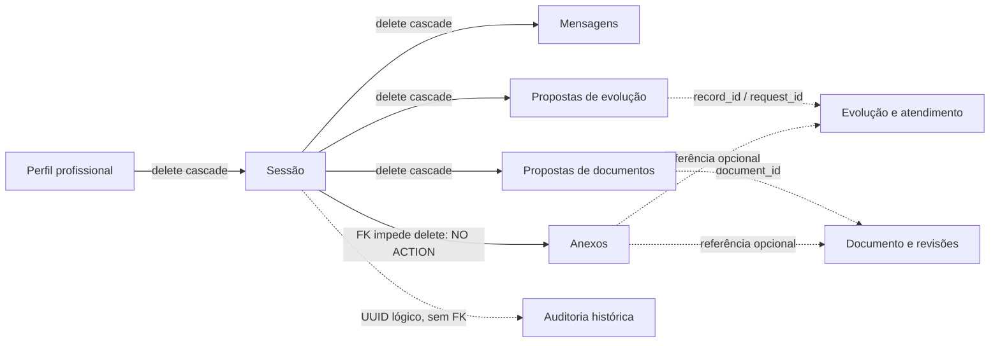
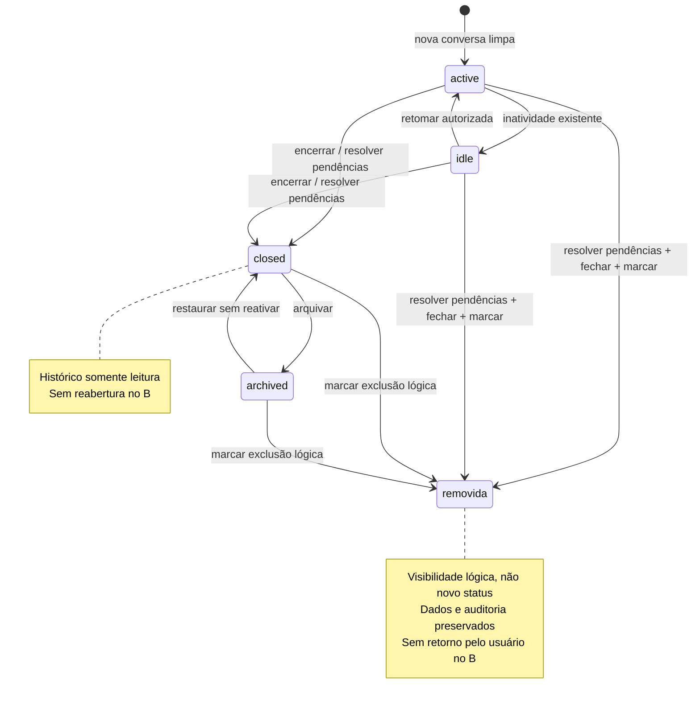
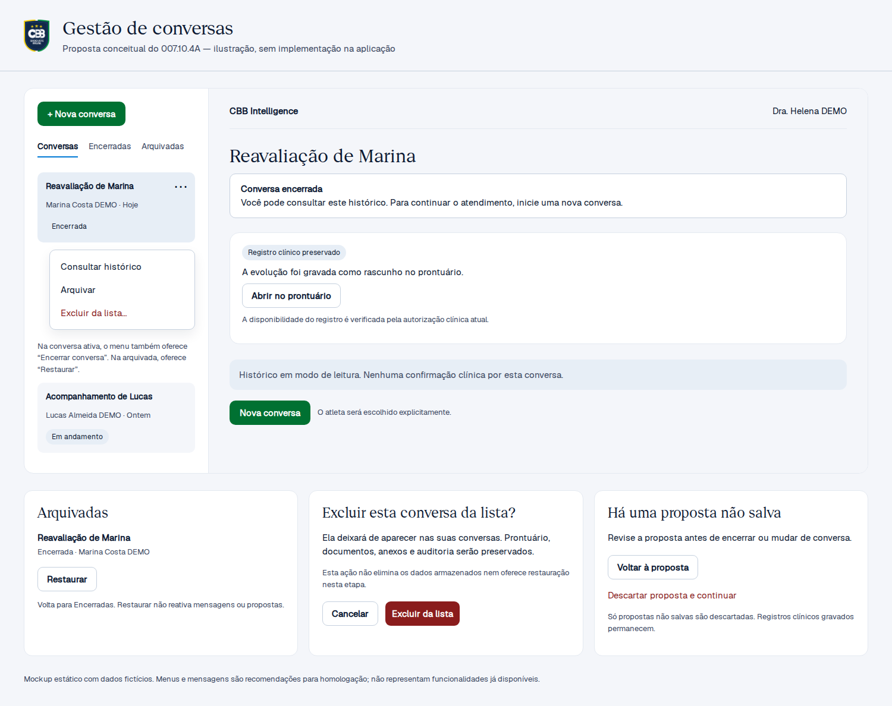

# HANDOFF 007.10.4A — Auditoria da gestão de conversas

18/11/2026. Diagnóstico técnico e de UX, **sem implementação**.

## Resultado e baseline

É viável adicionar encerramento consultável, arquivamento/restauração e exclusão lógica da lista. **Não é seguro implementar essas ações somente na sidebar.** Existem operações parciais no banco, mas faltam leitura sem reativação, gestão consistente das propostas pendentes, proteção de todos os caminhos de confirmação e uma política explícita para históricos após revogação de acesso clínico. Exclusão física não deve integrar o 007.10.4B.

Repositório `/home/tomaz/projects/prontuario-cbb`, workspace inicialmente limpo em **`f0dac25`**. Preservados `4bb69a0` (007.10.3B), `f0dac25` (filtros visíveis), `c5c0154` (menu/documentos) e os demais ancestrais. Branch documental criada em seguida: `docs/handoff-007-10-4a-conversation-audit`. Nenhuma mudança em produção, testes, dependências, migrações ou configuração do projeto.

### Método e limites

Inspeção das fontes e do catálogo PostgreSQL. Para exercitar os fluxos sem modificar a demo, foi criada uma instância **descartável independente**, API 56321, banco 56322 e aplicação 3200. O schema existente foi restaurado a partir de dump **somente de definições**, sem copiar dados da demo e sem executar migrações da aplicação. Foram restauradas as extensões já usadas pelo modelo. A equivalência das **114 funções e 143 constraints** em `public`/`clinical` foi verificada por hash das definições: [verificação](../visual/handoff-007-10-4a/schema-verificacao.json).

A cópia temporária da aplicação é exatamente `f0dac25`, compilada com webpack e as dependências existentes. Profissionais, atletas, propostas, registros e anexo usados são fictícios, criados somente na instância descartável. Foram exercitadas operações já existentes, sem criar operações de gestão novas. O anexo foi realmente enviado pela rota atual, sem envio de conteúdo à IA.

A proposta pendente foi registrada pela RPC atual; sua representação local foi carregada no `sessionStorage` pelo mecanismo existente de adoção do transcript, como nos testes do projeto. Isso reproduz o estado local de uma proposta sem chamar um provedor de IA. As capturas mostram **componentes reais da aplicação**, não mockups de telas. A imagem conceitual está identificada separadamente. Nenhum navegador visível foi aberto.

## Persistência atual e carregamento

| Elemento | Implementação real e consequência |
|---|---|
| Sessão | `clinical.conversation_sessions`: UUID, `professional_id`, `athlete_id` opcional, `status`, `started_at`, `last_activity_at`, `closed_at`. Proprietário é o profissional, não o atleta. |
| Estados | `active`, `idle`, `closed`, `archived`; não existe `deleted` ou marcador de exclusão lógica. Índice parcial garante uma sessão `active` por profissional. |
| Inatividade | `conversation_idle_stale` marca `idle` após 24 horas. É executada por RPCs de consulta/gestão; não foi identificado job autônomo para isso. Até uma listagem pode atualizar estado e auditar inatividade. |
| Mensagens | `clinical.conversation_messages`: UUID de linha, posição 0–39, `client_id`, papel user/assistant, texto até 4 mil caracteres e referências/cartões JSON. Unicidade por sessão/posição e sessão/client_id. |
| Histórico efetivo | Cliente mantém **as últimas 40 mensagens**; `conversation_save` substitui o conjunto persistido com DELETE/INSERT. Não é histórico ilimitado, append-only ou trilha imutável. IDs de linha e `created_at` das mensagens podem mudar ao salvar novamente. Nenhum DELETE foi usado nesta auditoria para testar exclusão de conversa. |
| Referências nas mensagens | `cards`, `navigation`, `search`, `draft`, `document`, `readings`, `analysis`, `attachments`, `clinical_search`. Não são FKs de documentos embutidas no JSON. Sanitizadores limitam formatos; corpos de propostas não salvas não entram nos campos finos `draft`/`document` do transcript persistido. |
| Texto livre | A coluna `text` e os previews podem conter conteúdo clínico digitado/gerado. “Cartão fino” **não significa que a conversa inteira esteja livre de dados sensíveis**. |
| Propostas de evolução | `clinical.draft_proposals`: request UUID, proprietário, sessão, atleta, texto, hash/versão, `discarded_at` e `record_id` opcional. O conteúdo não salvo pode existir nesta tabela, mesmo sem estar no histórico persistido. |
| Aprovação de evolução | `clinical.evolution_approvals`: profissional, atleta, request UUID, hash e registro salvo; a gravação usa `clinical_draft_approve`/`commit`. `request_id` correlaciona com atendimento/registro. Não é FK para sessão. |
| Propostas de documentos | `clinical.document_proposals`: request UUID, proprietário, sessão, atleta, tipo, conteúdo, hash/versão, descarte e documento salvo. Abrange prescrição, pedido cirúrgico e exames. |
| Registros clínicos | Evoluções em `clinical.records`/`encounters`; documentos em `clinical.documents`/`document_revisions`; anexos e objetos de Storage são recursos independentes. Arquivar a conversa não arquiva o prontuário. |
| Ferramentas | A apresentação do resultado é persistida nos cartões e referências; existem eventos de auditoria das operações clínicas. Não foi identificada tabela de histórico completo de cada tool call com todos os argumentos/resultados ou raciocínio do modelo. Isso não deve ser prometido como disponível. |
| Auditoria | `clinical.audit_events` guarda ator, recurso/UUID, operação, resultado, canal, método, aprovação e metadados seguros. Eventos de conversa incluem start/close/idle/archive/resume/context e negativas pertinentes. `resource_id` é referência lógica, sem FK para sessão. Não armazena o transcript completo. |
| Browser | Transcript/rolagem em memória e `sessionStorage` (`cbb-intelligence-turns:v1`, scroll); indicador de pendência em `cbb-unsaved-clinical:v1`. Conteúdo local pode diferir do que foi persistido. |
| Home limpa | Em `/` sem `atleta`, a página não carrega `conversation_current` e limpa o transcript apresentado. Mantém a lista recente. Isso **não encerra, arquiva ou apaga a sessão ativa do servidor**. |
| Retomada | Lista até 20 sessões próprias com texto, exclui arquivadas e vazias, ordena por atividade. Preview vem da primeira mensagem do usuário, até 72 caracteres. O parser da lista descarta status/messageCount; a UI não distingue encerrada/ativa/idle. |
| Contexto | Sessão tem um atleta atual mutável, enquanto mensagens/propostas podem referenciar atletas anteriores ou distintos. Não usar apenas `session.athlete_id` para decidir autorização ou destino de todas as referências. |

Fontes: [schema e RPCs iniciais](../../supabase/migrations/20261116000300_conversation_sessions.sql), [listagem/retomada atuais](../../supabase/migrations/20261116000400_conversation_resume.sql), [parser de conversa](../../src/features/chat/conversation.ts), [transcript](../../src/features/chat/transcript.ts), [Home no servidor](../../src/app/%28workspace%29/page.tsx), [interface](../../src/features/chat/intelligence-home.tsx). As funções foram conferidas no schema atual, incluindo alterações posteriores de documentos, histórico e anexos.

### Operações que já existem

| Operação atual | Disponibilidade e comportamento |
|---|---|
| `conversation_start()` | Nova sessão sem atleta/mensagens; fecha a ativa anterior e audita. Ação “Nova conversa” existente. Sessões vazias não aparecem na lista, mas podem permanecer no banco. |
| `conversation_close()` | RPC autenticada fecha a **ativa atual** do ator. Não recebe UUID do item escolhido. Não há ação correspondente no menu da UI/rota de sessão. |
| `conversation_archive(target)` | RPC autenticada do proprietário, somente closed/idle. Não há botão nem ação aceita na rota HTTP. Arquivada some de recent. Repetir archive em arquivada devolve seu payload; não é um leitor dedicado. |
| `conversation_resume(target)` | Nega outro proprietário; rejeita archived; fecha outra ativa e marca o alvo **active**, inclusive quando estava closed. Não é leitura sem efeitos colaterais. |
| `conversation_save(target,…)` | Exige sessão própria active; closed retorna closed. Não representa bloqueio universal de ferramentas/confirmadores. |
| `conversation_set_context(athlete)` | Atua na sessão ativa atual, com verificação de acesso ao atleta. A rota recebe sessionId, mas a RPC de contexto não o usa para escolher o alvo. Requer cuidado com abas concorrentes. |
| Restaurar/excluir logicamente | Não identificados no modelo, nas RPCs ou na UI. Não foram simulados como se fossem funcionalidades prontas. |

A rota [sessao/route.ts](../../src/app/api/inteligencia/sessao/route.ts) aceita **start, recent, resume, context, save**, exige mesma origem/sessão/perfil e valida UUIDs. `close`, `archive`, `restore`, `delete` não são ações HTTP implementadas. O acesso direto às RPCs continua relevante, pois funções públicas são concedidas a `authenticated` e verificam o ator internamente.

## Mapa de dependências e limites de remoção

As [FKs reais extraídas do catálogo](../visual/handoff-007-10-4a/dependencias.json) confirmam:

As setas `delete cascade` indicam o efeito de excluir o pai. Os vínculos pontilhados são de correlação/referência; não significam exclusão em cascata do prontuário ao excluir a proposta.

- **Sessão sem dependências clínicas ainda não é automaticamente descartável:** mensagens, propostas e auditoria têm valor de rastreabilidade/privacidade. Vazio na interface não prova ausência de proposta no banco.
- **Excluir fisicamente sessão:** apaga mensagens e propostas em cascata; perde snapshots/hashes e o elo sessão→proposta→registro. Anexo com `session_id` bloqueia a exclusão por FK. Auditoria não é apagada por essa FK, mas passa a apontar para recurso inexistente. Não executar.
- **Excluir mensagens isoladamente:** não exclui documentos/evoluções, mas perde contexto de confirmação e referências exibidas. Não necessário para a gestão proposta.
- **Excluir proposta:** não exclui o registro salvo referenciado; perde evidência de aprovação/correlação. Não usar para “limpar” lista.
- **Excluir documento/evolução/anexo:** é uma operação clínica própria; nunca consequência de encerrar, arquivar ou excluir conversa da lista. Algumas FKs de proposta usam SET NULL quando o recurso clínico é removido; isso não autoriza essa remoção.
- **Encerrar/arquivar/excluir logicamente:** podem preservar UUID, mensagens, propostas, registros, arquivos e eventos. Não liberam armazenamento significativo. A política de retenção e eventual purga é uma decisão separada, não aprovada aqui.
- **Excluir perfil profissional:** já tem cascatas para sessões/propostas. A existência dessa FK não equivale a uma política aprovada de eliminação de dados do profissional; gestão de contas fica fora do 007.10.4B.

## Achados e riscos priorizados

As prioridades abaixo indicam especialmente os bloqueios para lançar o 007.10.4B; não significam que alguém tenha apagado prontuários na baseline.

| Prioridade / achado | Evidência e impacto | Recomendação / complexidade |
|---|---|---|
| **P0 — Encerrada não é leitura** | Resume de sessão closed a tornou active. Parser só aceita active. Save rejeita closed, mas não há leitor por UUID sem reativar. | Separar consultar de retomar; visualização closed/archived somente leitura. Operação direcionada ao UUID, sem fechar a sessão errada. Média/alta. |
| **P0 — Confirmação após arquivar** | Proposta fictícia registrada, sessão fechada/arquivada e `clinical_document_confirm_card` ainda retornou ok/criou documento. `document_store` revalida autoria clínica, mas não a situação da sessão. | Definir contrato de pendências e guardas de ciclo de vida em todas as confirmações originadas do chat, inclusive chamada direta. Não bloquear edição clínica tradicional do registro salvo. Alta. |
| **P0 — Falta de vínculo de proposta salva pode falsear pendências** | `clinical_draft_proposal_attach` retornou `column reference "request_id" is ambiguous` na cópia de funções idênticas. A evolução foi salva; a action chama attach sem validar erro. Proposta pode continuar sem record_id e parecer pendente. | Pré-requisito explícito: corrigir referência ambígua e conferir retorno/correlação sem mudar o conteúdo clínico. Não descartar proposta com registro já salvo por confiar apenas em record_id nulo. Média. |
| **P0 — Contrato de acesso ao histórico após revogação não está resolvido** | Após retirar o acesso ao atleta na fixture, recent ocultou athleteId, mas manteve preview; resume próprio devolveu athleteId e texto histórico. Não houve acesso a conversa de outro profissional. | Definir política de autorização atual para texto/previews/referências. Recomenda-se ocultar conteúdo clínico sem autorização atual; quando não for possível redigir texto livre com segurança, retornar indisponibilidade neutra. Não presumir que ocultar o nome protege o transcript. Alta. |
| **P1 — Troca perde a proposta local sem aviso equivalente** | “Nova conversa” pediu confirmação e cancelar manteve a proposta. Clicar em outra conversa não pediu; a proposta não salva continuou no banco, fora do transcript retornado. | Uma guarda comum para trocar, encerrar, arquivar, excluir e sair, cobrindo todas as propostas/transferências. Descartar só com escolha explícita. Média. |
| **P1 — Proteção local é um booleano compartilhado** | Cards de proposta e salvos escrevem no mesmo indicador de unsaved. Não foi demonstrada cobertura de todas as combinações de vários cards. | Agregar pendências por sessão/request, não confiar só no browser; testar múltiplas propostas e conteúdo editado. Média. |
| **P1 — Limites de histórico e lista pouco explícitos** | 40 mensagens por sessão; 20 sessões na lista; não há paginação/“Ver mais” nem consulta de arquivadas. | Paginar sessões por bucket, preservar ordenação estável e informar limite histórico real. Histórico integral requer handoff separado, sem prometer recuperação de texto já substituído. Média. |
| **P1 — Concorrência pode atingir a sessão ativa errada** | Close/context usam a ativa do servidor; ferramentas/preparo podem criar ou usar a ativa; rota de IA não recebe um contrato obrigatório de sessão fechada em leitura. Front usa abort/epoch/fila, mas isso não substitui controle transacional no servidor. | IDs explícitos, estado esperado, bloqueio por proprietário/sessão e revalidação após operações em andamento. Incluir voz, upload, stream e duas abas. Alta. |
| **P1 — Estados não distinguíveis na sidebar** | `parseHistory` elimina status; todos os itens usam mesma apresentação, sem menu. “Encerrar contexto” remove atleta e não encerra sessão. | Badge discreto, três pontos e termos distintos. Não renomear “Encerrar contexto” como se fosse encerramento de conversa. Baixa/média. |
| **P2 — Títulos longos e identificação das ações** | Preview truncado na lista desktop/mobile. Não existe ação por item nem leitura alternativa de estado. | Preservar título acessível completo disponível, label “Ações da conversa …”, alvo de toque de 44px, foco visível. Baixa. |

Fontes dos achados adicionais: [propostas de evolução](../../supabase/migrations/20261116000800_context_and_spoken_draft.sql), especialmente attach:117–133; [action de gravação](../../src/features/chat/clinical-draft-actions.ts), linha 60; [propostas/confirmadores de documentos](../../supabase/migrations/20261116000900_document_proposals.sql), `document_store`/`clinical_document_confirm_card`; [anexos](../../supabase/migrations/20261118000100_clinical_attachments.sql); [fim de contexto](../../src/features/chat/conversation-actions.ts). Não foram corrigidos neste diagnóstico.

## Cenários e capturas atuais

[Observações estruturadas e respostas obtidas](../visual/handoff-007-10-4a/observacoes.json). Chromium headless; desktop 1440×900, mobile 390×844 e 320×844; pt-BR e America/Sao_Paulo. Nenhum overflow horizontal medido nas capturas.

| Cenário solicitado | Resultado / evidência |
|---|---|
| 1. Vazia | Sessão vazia real criada; recent não a lista. [Home sem mensagens](../visual/handoff-007-10-4a/home-limpa-1440.png). Vazia não significa apagada no banco. |
| 2. Atleta em contexto | [Conversa e painel de Marina](../visual/handoff-007-10-4a/conversa-contexto-1440.png). Encerrar contexto é independente de encerrar sessão. |
| 3. Extensa | 40 mensagens persistidas, consulta/rolagem. [Captura](../visual/handoff-007-10-4a/conversa-extensa-1440.png). Não representa histórico ilimitado. |
| 4. Ação clínica confirmada | Evolução e prescrição fictícias gravadas como rascunho; [cartão de evolução salvo](../visual/handoff-007-10-4a/acao-confirmada-1440.png). Registros continuam existentes ao final. |
| 5. Proposta pendente | [Proposta real no componente](../visual/handoff-007-10-4a/proposta-pendente-1440.png), [cancelar Nova conversa](../visual/handoff-007-10-4a/proposta-preservada-apos-cancelar-1440.png), [troca para outra conversa](../visual/handoff-007-10-4a/retomada-com-proposta-anterior-1440.png). Uma proposta permaneceu no banco sem gravação clínica. |
| 6. Anexo | Upload real 200; [conversa com anexo](../visual/handoff-007-10-4a/conversa-anexo-1440.png). Vínculo session_id real; arquivo fictício do design lab. |
| 7. Outro profissional | RPC denied e HTTP 403; sessão ausente da lista do proprietário testado. Não foram capturados textos privados do outro usuário na interface. |
| 8. Arquivada | RPC existente arquiva closed e remove de recent; resume retorna invalid/HTTP 400. Não há tela atual de arquivadas/restaurar para capturar. A lista da Home já omite a fixture arquivada. |
| 9. Encerrada | Aparece em recent, save retorna closed; clicar retoma como active. Capturas de contexto/ação confirmada são após essa reativação, não um modo readonly inexistente. |
| 10. Removida da lista | Arquivar já remove da lista. **Exclusão lógica não existe**: action delete recebeu HTTP 400; nenhum registro foi excluído para simular essa funcionalidade. |
| 11. Login/Home limpa | Login abriu `/` com composer vazio e zero turnos apresentados, mantendo lista anterior. [Captura](../visual/handoff-007-10-4a/home-limpa-1440.png). |
| 12. URL/identificador | `/?sessao=UUID` não seleciona sessão: parâmetro ignorado pela página. [Captura](../visual/handoff-007-10-4a/url-identificador-ignorado-1440.png). Via API, UUID alheio foi negado e arquivado rejeitado; anônimo recebeu 401. |
| Mobile | [Conversa 390](../visual/handoff-007-10-4a/conversa-mobile-390.png), [lista 390](../visual/handoff-007-10-4a/lista-mobile-390.png), [lista 320](../visual/handoff-007-10-4a/lista-mobile-320.png). Drawer existente; não há menu por conversa. |

A interface já tem foco inicial/retorno e Escape para a lista mobile. A adição de menu/modal deve preservar isso e testar contenção de foco e sobreposição, sem transformar a sidebar inteira em um redesign. Não foi executada auditoria certificadora de acessibilidade, teste em aparelho físico, leitor de tela ou Safari.

## Contratos recomendados para o 007.10.4B

São **propostas para aprovação**, não APIs implementadas. Preservar UUIDs, ownership e recursos clínicos. Toda ação deve selecionar explicitamente a sessão do item, validar proprietário/visibilidade/estado esperado e ser transacional. Não aceitar `professional_id` ou timestamps de auditoria enviados pelo cliente.

### Encerrar

- Em active/idle, resolver pendências antes da transição para closed. Sem pendências, encerrar diretamente, com retorno visível; não exigir confirmação genérica em todo clique.
- Com proposta local/servidor, oferecer **Voltar à proposta** ou **Descartar proposta e encerrar**. Descarte explícito é marcação, preservando evidências; nunca apagar proposta em cascata. Conferir se o request já produziu registro antes de classificá-lo como não salvo.
- Enquanto há gravação/confirmador/upload em andamento, aguardar resolução ou bloquear a ação com explicação. Parar voz/stream e revalidar no servidor; abortar a requisição do navegador não prova cancelamento de uma gravação já iniciada.
- Closed aceita consulta autorizada, mas não mensagens, novos preparos, upload pelo chat, edição/confirmação de proposta ou finalização pelo cartão dessa conversa. Rascunhos já gravados continuam acessíveis no prontuário, com as regras clínicas existentes.
- **Não incluir reabertura de closed no primeiro 007.10.4B.** “Nova conversa” cria sessão limpa e exige escolha explícita do atleta. Reabertura futura precisa de contrato próprio: não reativar propostas antigas, nem trocar a ativa de outra aba silenciosamente.
- Não basta esconder composer: validar o estado em endpoints, ferramentas e confirmadores do canal chat. Um documento ainda pode ser editado pelo fluxo clínico tradicional autorizado; o encerramento da conversa não congela o prontuário.

### Arquivar e restaurar

- Arquivar oculta da lista principal e mantém histórico/UUID. Se active/idle, resolver pendências e encerrar antes, na mesma operação de gestão; não chamar uma sequência vulnerável a corrida de RPCs no browser.
- Exibir bucket **Arquivadas**, com consulta readonly e **Restaurar**. Não depender de `conversation_resume`, que hoje reativa.
- Restaurar retorna a **closed**, na lista de encerradas e no conjunto principal não arquivado, sem reabrir mensagens, copiar conteúdo ou restaurar proposta descartada. Essa regra elimina a necessidade de inferir um estado anterior perdido por `status='archived'`.
- Arquivar/restaurar sem pendência é reversível e não exige modal. Mensagem “Conversa arquivada. Restaurar” deve nomear o efeito real: a restauração não reativa atendimento.

### Excluir da lista: somente lógica

- Acrescentar, **somente no futuro handoff aprovado**, marcador de exclusão lógica (`deleted_at`, autor obtido no servidor ou evento equivalente). Manter os quatro estados existentes; exclusão é visibilidade, não uma nova autorização clínica. Não precisamos de novo estado terminal textual para representar isso.
- Antes de marcar removida, resolver pendências e fechar a sessão ativa. Nenhuma removida pode continuar ocupando o índice de active. Preservar dados, hashes, propostas, mensagens, correlações, arquivos e auditoria.
- Ocultar removidas de todos os buckets. Bloquear leitura/retomada/contexto/save/archive/restore e caminhos indiretos por request/proposta dessa sessão, inclusive RPC direta e abas antigas. Não retornar payload por um caminho idempotente de archive.
- Exigir **uma confirmação específica**, com foco inicial em Cancelar: “Excluir esta conversa da lista? Ela deixará de aparecer nas suas conversas. Prontuário, documentos, anexos e auditoria serão preservados.” Informar que a ação não elimina os dados armazenados e não oferece restauração nesta etapa.
- Não incluir lixeira, restauração de removidas, purga, limpeza do Storage, cascatas ou prazo de retenção no B. Retenção/acesso administrativo, descarte posterior, backups e eventual solicitação de eliminação exigem política separada aprovada. Não prometer “apagado definitivamente”.

### Autorização, erros e auditoria

O proprietário continua sendo o usuário autenticado. Acesso clínico e acesso à própria conversa são verificações diferentes. Recomenda-se exigir autorização atual apropriada ao tipo de referência: cadastro, evolução restrita, documento e anexo têm regras distintas. Para texto livre de contexto clínico cuja segurança não possa ser reconstruída, usar indisponibilidade neutra ao perder acesso; **não mostrar preview, atleta, título, trecho ou contagem de recursos restritos**. Essa decisão deve ser aprovada como política antes de alterar a leitura histórica existente; simplesmente filtrar o nome do atleta é insuficiente.

Sugestão de respostas: 401 sem sessão; 403 para origem inválida; indisponibilidade uniforme/404 para UUID alheio, inexistente ou removido, sem metadados; 409 para conflito de estado/pendência de sessão própria autorizada. Consulta de archived própria autorizada é permitida em readonly; não deve ser confundida com removed.

Auditar close/archive/restore/remove, tentativas negadas e conflitos relevantes com ator, UUID da sessão, operação, resultado, estado anterior/próximo e canal/método. Usar a infraestrutura existente e metadados mínimos, sem texto de mensagens, conteúdo de propostas, títulos clínicos ou nomes no evento. Preservar todos os eventos anteriores. Corrida/timeout deve deixar estado anterior ou transição completa, nunca metade da gestão aplicada.

### Estados e transições

`removida` representa `deleted_at` preenchido, não um valor a adicionar silenciosamente ao CHECK atual. Ler closed/archived não deve ativar sessão, limpar `closed_at`, atualizar atividade como se houvesse mensagem ou afetar a ativa de outra aba. A inatividade de 24 horas permanece; não introduzir expiração arbitrária de proposta neste ajuste.

## Proposta de UX

[HTML estático da proposta](../visual/handoff-007-10-4a/proposta-conceitual.html). Ilustração com Geist Sans/Serif e escudo/tokens CBB existentes; não é captura de funcionalidade disponível nem publicação da aplicação.

Manter sidebar, tipografia, Home limpa e painel de atleta. Acrescentar menu de três pontos por conversa, separado do botão que abre o histórico; evitar buttons aninhados. No desktop, pode aparecer em hover **e** foco; no mobile, permanecer visível, com alvo de toque suficiente. Nome acessível “Ações da conversa [título]”, estado expandido, Enter/Espaço, setas no menu, Escape e retorno ao botão de origem. Depois de remover o item, foco no próximo item ou no título da lista; confirmar exclusão com foco contido e devolução coerente.

| Estado da conversa | Ações de menu |
|---|---|
| active / idle | Consultar/retomar conforme estado, Encerrar conversa, Arquivar, Excluir da lista… |
| closed | Consultar histórico, Arquivar, Excluir da lista…; banner readonly e Nova conversa |
| archived | Consultar histórico, Restaurar, Excluir da lista… |
| removida | Nenhum item nem menu; URL/ID indisponível para o fluxo comum |

Filtros simples **Conversas**, **Encerradas**, **Arquivadas**: Conversas contém o conjunto próprio não arquivado/não removido; Encerradas é uma visão filtrada desse conjunto. Usar badge de estado discreto e paginação server-side com desempate por ID, sem filtrar apenas as primeiras 20 entradas. Manter contagem restrita ao bucket autorizado. Uma conversa vazia pode ser omitida da lista sem ser fisicamente excluída.

Ao consultar closed/archived, manter links de recursos apenas quando a autorização atual permitir; retirar botões de confirmação do histórico, preservando “Abrir no prontuário”. No mobile, reutilizar o drawer existente, sem criar uma segunda navegação. Não adicionar redesign, menu global de ferramentas clínicas ou mudança na escolha de atleta.

## Escopo fechado recomendado para o 007.10.4B

**Pré-requisitos de aprovação:** política de leitura histórica após perda de acesso; sem reabertura de closed; restaurar archived como closed; exclusão apenas lógica, sem restauração de removidas/purga. O 4B não deve iniciar com esses pontos implícitos.

1. **Integridade das pendências:** corrigir o vínculo ambíguo de evolução salva e tratamento de erro de attach; conferir correlação com registro/approval antes de apresentar pendência. Manter a semântica de confirmação, corpo clínico e idempotência existentes. Cobrir esse pré-requisito com teste que valide a linha da proposta, não só o registro criado.
2. **Contratos do servidor:** leitura por UUID sem reativar; listagem paginada dos três buckets; operações direcionadas close/archive/restore/remove; marcador lógico e autorização completa, com transação, idempotência e controle de concorrência. Migração mínima de visibilidade será proposta e revisada apenas no B.
3. **Guardas do canal chat:** envio, contexto, preparos, confirmação de evolução/documentos/exames, finalização no cartão, anexos e voz devem conhecer a sessão/estado esperado. Preservar operações clínicas tradicionais e verificar autorização por recurso; nenhuma ampliação de acesso.
4. **UI pontual:** menu por item, labels de estado, filtros, readonly e guarda comum de pendências. Modal somente para exclusão e descarte explícito. Feedback/erro recuperável, foco, teclado e mobile.
5. **Verificação e homologação:** testar dependências preservadas, acesso direto e concorrência; executar direcionados, suíte completa, lint/typecheck/build; capturas reais antes/depois e aprovação antes de merge/publicação.

**Fora:** apagar sessão/mensagem/proposta/arquivo fisicamente; reabrir closed; restaurar removida; modificar retenção de backups; excluir contas; implementar histórico ilimitado ou log completo de tools; mudar modelo clínico, semântica esportiva, CSV, agente/modelo de IA, assinatura/emissão ou redesenhar Home/perfil. A janela de 40 mensagens é limitação explícita; corrigir sua persistência integral requer escopo separado.

Complexidade global estimada **alta**: a sidebar é pequena, mas a proteção precisa atravessar servidor, banco e confirmadores. Separar visualmente os commits não permite lançar a UI antes das guardas.

## Testes necessários no B

- **Estados:** todas as transições permitidas/proibidas; ler closed/archived sem ativar; restaurar como closed; removida indisponível em qualquer bucket/ID; operação repetida idempotente; sessão vazia omitida sem exclusão.
- **Autorizações:** anônimo, sem perfil, proprietário, outro profissional, UUID inexistente, atleta em contexto trocado, perda de acesso ao cadastro/à clínica, evolução sigilosa e anexo de outro autor. Validar corpo das respostas e previews, não somente status HTTP. Exercitar RPC direta e HTTP, incluindo caminhos indiretos de proposal/request.
- **Integridade:** fotografar contagens/IDs/hashes/versões e eventos de registros, encounters, approvals, propostas, documentos/revisões e anexos antes/depois de cada operação. Arquivo continua no Storage e no prontuário autorizado. Não usar DELETE clínico como limpeza da conversa.
- **Pendências:** evolução, prescrição, cirurgia e exames; várias simultâneas; proposta local modificada; proposta no servidor sem cartão local; proposta já salva com attach parcial; descarte explícito versus cancelar; nenhuma pendência antiga executada após close/archive/remove.
- **Concorrência:** duas abas; stream e ferramenta em andamento; confirmação já iniciada; upload em transferência/finalização; voz ativa; mudança de atleta; duplo clique, retry, offline, resposta tardia e rollback. Alvo da operação é o UUID selecionado, nunca outra ativa atual por acidente.
- **Navegação:** login e Home limpa sem ressuscitar sessão; nova conversa sem herdar atleta; retorno/refresh/Back; link de sessão autorizada; lista >20 com paginação real; preservar contextos de documentos existentes e não confundir “Encerrar contexto”.
- **UX/acessibilidade:** desktop 1440 e mobile 390/320, nomes longos, contraste, overflow, menu acessível sem hover obrigatório, Escape, Tab, foco após excluir/restaurar, diálogo com foco contido e mensagens de erro. Confirmar manualmente com leitor de tela/aparelho em homologação.

## Validação e estado final

O build da **cópia temporária de `f0dac25`** passou. As verificações desta auditoria são inspeção de catálogo/fontes e cenários direcionados de interface/RPC/HTTP, registrados no JSON; **não são uma nova execução da suíte integral de 73 testes**. Lint/typecheck/suíte completa não foram repetidos porque o repositório recebeu somente documentos/evidências, sem alteração de código da aplicação. Os resultados da entrega anterior permanecem no relatório 007.10.3B.

Entregues este relatório, **12 capturas reais**, uma proposta conceitual em HTML/PNG e JSONs de observações, dependências, equivalência e validação. Conferidos links locais e `git diff --check`.

O diff de `src/`, `supabase/`, `tests/`, `scripts/` e dependências contra `f0dac25` está vazio. A branch de implementação `feat/handoff-007-10-3b-athlete-directory` permanece em `f0dac25`; esta entrega documental fica na branch `docs/handoff-007-10-4a-conversation-audit`, em commit local. Nenhum merge, push ou publicação.

A instância descartável foi encerrada com filtro explícito de projeto; seus containers/volumes e a cópia temporária foram removidos. Os seis containers originais da demo permaneceram em execução. Nenhum registro da demo foi excluído ou alterado pela auditoria. O processo de desenvolvimento preexistente foi preservado.

[Registro final de validação](../visual/handoff-007-10-4a/validacao.json). A implementação do 007.10.4B depende da aprovação dos contratos e da resolução dos bloqueios descritos; este handoff não os implementa.
