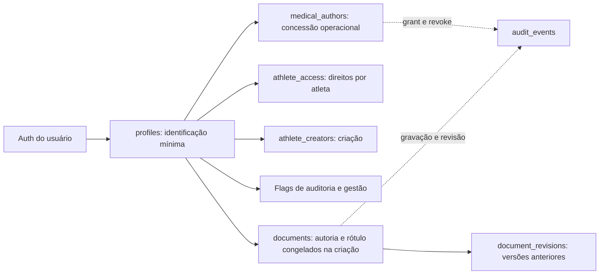
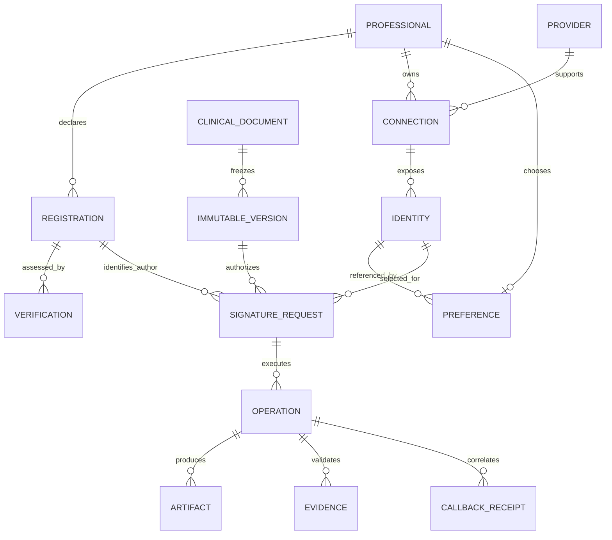
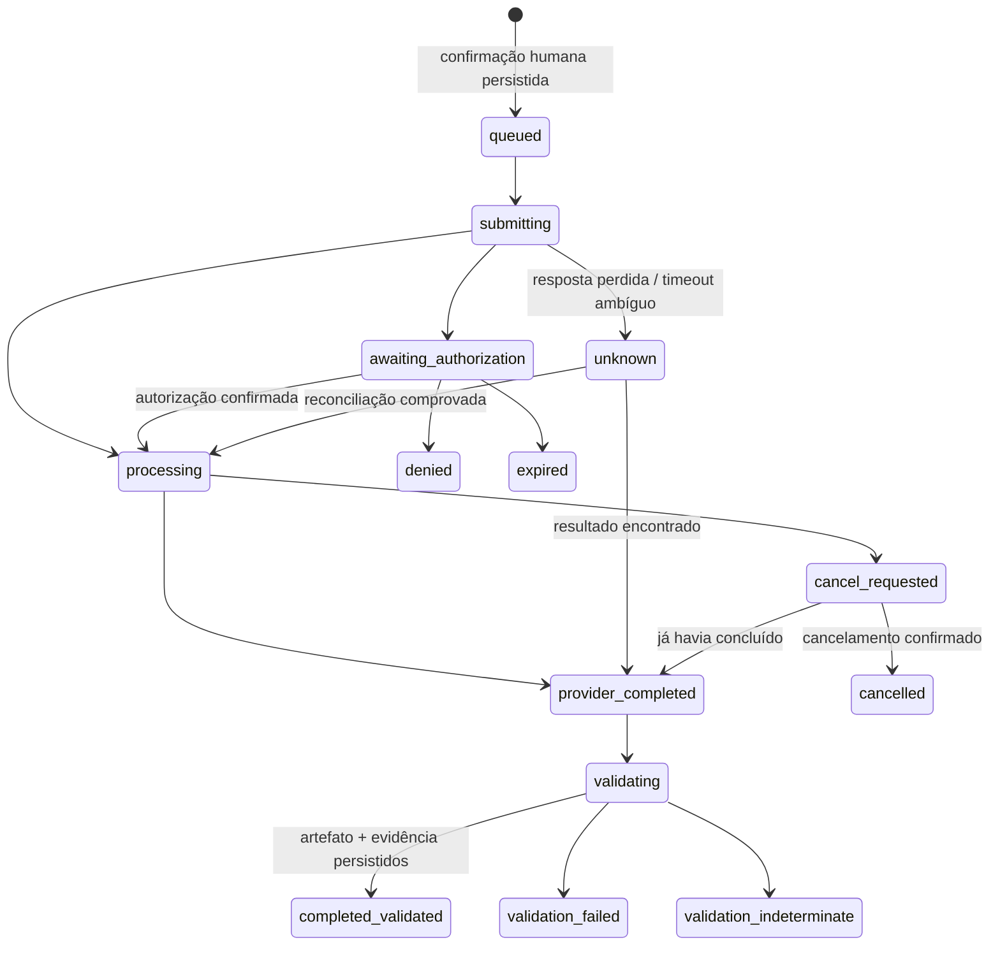

# HANDOFF 007.10.6A — Perfil profissional e assinatura digital multiprovedor

20/11/2026. Discovery técnico e de UX, sem implementação.

## Conclusão e baseline

O perfil profissional atual é mínimo e **não possui tela própria de consulta/edição**. A aplicação identifica o usuário no cabeçalho e mantém concessões operacionais de acesso/autoria médica. Não há domínio estruturado de inscrições em conselhos, verificação institucional, provedores, conexões, certificados ou operações de assinatura.

Recomenda-se acrescentar um perfil profissional complementar e um motor de assinatura separado do fluxo de rascunhos. Um profissional poderá ter múltiplas inscrições, conexões e identidades, inclusive várias do mesmo provedor. Nenhum fornecedor é obrigatório. **Bird ID permanece uma possibilidade futura**, sem endpoints, tokens ou payloads escolhidos aqui.

Repositório WSL `/home/tomaz/projects/prontuario-cbb`, início limpo em `main`, commit **`162b9a9`**, preservando a baseline `prototype-demo-2026-11-18` e os handoffs anteriores. Branch documental: `docs/handoff-007-10-6a-professional-signing-audit`. Foram lidas fontes, rotas e metadados do banco em transações `READ ONLY`; não houve autenticação de teste, gravação, migração, captura de credenciais ou chamada a provedor de assinatura.

## 1. Auditoria da experiência e do domínio atuais

| Aspecto | Evidência atual | Diagnóstico e implicação |
|---|---|---|
| Tela do profissional | Layout mostra avatar, `display_name`, `profession` e Sair. Seções e rotas não incluem Meu perfil. | Falta uma área para consultar e corrigir dados do próprio profissional. Não confundir o perfil longitudinal do atleta com essa tela. |
| API de perfil | `GET /api/profile` retorna o perfil autenticado e usa private/no-store; não há POST/PATCH. | Identificação da sessão, não cadastro profissional completo. |
| Dados pessoais/contatos | `public.profiles` tem somente id, nome de exibição, profissão, can_read_audit e can_manage_access. O login pertence ao Auth. | Não há nome civil separado, telefone ou e-mail profissional de contato no perfil. E-mail de autenticação não deve virar contato verificado por suposição. |
| Profissão/especialidade | `profession` é texto de exibição; não existe especialidade profissional estruturada. | Não conceder direitos com base no texto digitado ou inferido. |
| Conselho/inscrição/jurisdição | `clinical.medical_authors.credential_label` é um rótulo livre, opcional, até 80 caracteres. | Não permite múltiplas inscrições nem identifica conselho, número, jurisdição e validade separadamente. Não tratar o rótulo como inscrição comprovada. |
| Habilitação institucional | medical_authors mantém enabled, granted_by e granted_at. | É uma concessão operacional. Não há evidência estruturada de consulta a conselho ou verificação institucional de credenciais. |
| Permissões clínicas | medical_authors habilita autoria médica; athlete_access concede leitura/edição/escrita/finalização por atleta; athlete_creators controla criação; profiles controla auditoria/gestão. | Preservar esses controles. Cadastro, verificação de inscrição e conexão com provedor não podem alterá-los automaticamente. |
| Autorização atual | RLS de profiles permite leitura do próprio perfil. authenticated tem SELECT, sem UPDATE direto. RPCs de autoria validam gestor; a concessão via RPC não permite autoconcessão. | Há uma separação útil entre identidade de sessão e direitos operacionais; a futura edição deve usar whitelist de campos e manter as flags protegidas. |
| Autoria em documentos | document_save obtém o ator do Auth e grava author_id, author_name e credential_label na criação. O preview mostra esses campos. | Existe snapshot de identificação, não assinatura criptográfica. Mudança futura no cadastro não deve reescrever documentos antigos. |
| Versões clínicas | documents tem version, content e status; document_revisions registra o conteúdo/status anterior, ator e versão. | A revisão JSON não é um PDF imutável assinado; faltam bytes canônicos congelados, hashes, identidade de assinatura e evidências de validação. |
| Auditoria | Grant/revoke de autoria médica e gravações de documentos geram eventos. Não há edição de perfil na UI nem triggers de alteração em profiles/medical_authors no catálogo inspecionado. | Não existe trilha geral de edição cadastral profissional a reutilizar como se já estivesse pronta. Acrescentá-la no B, sem alterar eventos históricos. |
| Assinatura/emissão | DocumentStatus admite draft e ready_for_review. O preview declara NÃO ASSINADO/NÃO EMITIDO. Não há rota/conector de assinatura. | Revisão interna não é assinatura nem emissão. O PDF viewer de anexos e a dependência pdf-lib não constituem motor de assinatura ou gerador de documento clínico final. |

Fontes: [API](../../src/app/api/profile/route.ts), [perfil autenticado](../../src/lib/profile.ts), [layout](../../src/app/%28workspace%29/layout.tsx), [seções](../../src/features/sections.ts), [domínio médico/RPCs](../../supabase/migrations/20261116000100_clinical_documents.sql), [tipos do documento](../../src/features/documents/content.ts), [preview](../../src/features/documents/preview.tsx), [metadados extraídos em leitura](../visual/handoff-007-10-6a/dominio-atual.json) e [inventário de rotas](../visual/handoff-007-10-6a/inspecao.json).

### Evidência visual atual

[Captura real já versionada do cabeçalho profissional](../visual/handoff-007-10-3b-inline-filters/lista-10-1440.png), produzida na baseline anterior de mesma implementação visual. É uma captura histórica com dados fictícios, não uma nova sessão autenticada em 20/11. Não foi produzida uma captura de tela de perfil inexistente. As imagens da seção visual abaixo são **propostas**, identificadas como não implementadas.

### Mapa do domínio existente



Inscrição declarada, verificação institucional e certificado são conceitos ausentes desse mapa atual. **Enabled não será renomeado para “registro profissional verificado”.**

## 2. Modelo de dados proposto

Nomes abaixo são conceituais; não são tabelas, migrations ou RPCs criadas neste handoff. Manter Auth/profiles e permissões atuais, acrescentando relações por UUID. Não introduzir colunas de token ou certificado diretamente em profiles.

| Entidade proposta | Responsabilidade e relações |
|---|---|
| professional_details | Complemento 1:1 de profiles: nome civil/profissional, contatos declarados e profissão/especialidades declaradas. Campos de contato não substituem automaticamente e-mail de login. Versionamento/auditoria da edição. |
| professional_registrations | N inscrições por profissional: conselho/autoridade, país, número original/normalizado, categoria e jurisdição tipada. Jurisdição pode ser UF, região ou nacional; não forçar todo conselho ao formato CRM/UF. Unicidade por profissional, autoridade, jurisdição e número normalizado. |
| registration_verifications | Histórico independente por inscrição: declarada, em verificação, verificada, recusada, expirada ou suspensa; instituição/verificador, evidência protegida e datas. Verificada não altera medical_authors/athlete_access. |
| signature_providers | Catálogo de conectores por chave estável/versão, disponibilidade e capacidades. Sem enum fechado de marcas. Registro vazio é um estado válido do produto. |
| signature_connections | N conexões por profissional/provedor: vínculo com conta externa, modelo de autorização, estado, expiração quando conhecida, epoch de autorização e referência a segredos no cofre. Uma conexão pode não exigir credencial permanente. |
| signing_identities | N identidades por conexão; profissional proprietário explícito e consistente. Referência externa opaca, tipo certificado/identidade remota, metadados observados, sujeito verificado, fingerprint/issuer/serial/validade quando disponíveis e relatório de verificação. Não usar apenas nome exibido como chave. |
| signature_preferences | Preferência padrão do profissional apontando para uma identidade própria, com unicidade transacional. Não manter vários booleanos is_default sujeitos a corrida. Preferência é sugestão; não é consentimento para assinar. |
| immutable_document_versions | Documento e versão clínica de origem, conteúdo canônico e hash, bytes exatos preparados e hash, versão do renderizador, snapshots de autor/inscrição e política. Original imutável privado; não sobrescrever o draft nem depender de renderização futura do browser. |
| signature_requests | Intenção humana vinculada a uma versão imutável, proprietário/signatário, inscrição escolhida, identidade/conexão, hashes, política, confirmação e prazo. Mudança de conteúdo, identidade ou inscrição exige nova confirmação. |
| signature_operations | Execução do pedido: tentativa, chave de idempotência, correlação externa, adapter version, auth epoch, estado operacional e resultado remoto observado. Um pedido pode ter tentativas controladas; não criar segunda assinatura após timeout sem reconciliar a primeira. |
| signature_evidence | Evidências do provedor e relatório de validação independente, checks realizados, política/trust store/instantes e resultado. Separar horário alegado de assinatura de horário efetivamente comprovado. Dados sensíveis ficam protegidos. |
| signature_artifacts | Objetos privados e imutáveis de entrada, documento assinado, comprovante e relatório, com hash/tamanho/MIME e vínculo a pedido/operação/versão. Artefato publicado só após validação e persistência completas. |
| signature_callback_receipts | Inbox durável e deduplicável para eventos de provedor: correlação, identificador de evento quando houver, digest e decisão de autenticação/processamento. Sem OTPs, headers de autorização ou payload sensível em logs. |

### Invariantes do modelo

- Um profissional tem várias conexões e várias identidades; duas identidades do mesmo provedor continuam distintas. Identidade, preferência, request e conexão devem pertencer ao mesmo profissional, garantido também por FKs/constraints compostas ou checagens transacionais, além do servidor.
- Certificado vinculado não significa inscrição profissional verificada. Inscrição verificada não concede acesso ao atleta. Um psicólogo não passa a emitir prescrição médica por conectar certificado ou editar a profissão.
- A habilitação para assinar depende da autorização clínica atual para o documento, da inscrição/verificação exigida pela política e da identidade utilizável do signatário. A política não aceita mera igualdade de display_name; divergência de identidade exige resolução verificada, sem correspondência aproximada automática.
- Identidade remota sem metadados de certificado não deve ser exibida como “certificado válido”. Se não satisfizer o tipo/nível de assinatura exigido para o documento, fica incompatível.
- Renovação ou troca de chave cria nova identidade ou versão imutável de identidade; o certificado histórico não é sobrescrito sob um alias do provedor. O pedido congela a identificação verificável aprovada, incluindo fingerprint quando aplicável. Certificado diferente do escolhido exige nova confirmação.
- Desconectar ou trocar a preferência não remove identidades/evidências históricas. Referências de assinatura não devem usar cascatas que apaguem artefatos, versões ou auditoria quando a conexão for removida da lista.
- Não escolher outro certificado/provedor silenciosamente se o preferencial estiver vencido, revogado ou indisponível. Não misturar autorização ou segredos de usuários distintos do mesmo fornecedor.



## 3. Contrato interno dos conectores

Separar o orquestrador, as regras clínicas e o validador do adaptador de transporte. O frontend recebe DTO próprio da aplicação, não o payload bruto do fornecedor. Nenhum endpoint, header, nome de token ou payload de marca é fixado aqui.

| Operação abstrata | Obrigatoriedade / contrato |
|---|---|
| describeCapabilities | Obrigatória para registro do adaptador. Declara versão, formatos/níveis atendidos, modos de autorização, descoberta de identidades, callbacks/polling, cancelamento e revogação remota. Capacidades efetivas podem variar por conexão/identidade. |
| beginConnection / completeConnection | Opcionais para provedores que tenham conexão/autorização em etapas. Podem devolver desafio externo ou conclusão imediata; não presumir OAuth ou refresh token. O motor protege a correlação/expiração. |
| inspectConnection | Opcional quando o fornecedor permite consulta. Diferenciar estado local conhecido e estado remoto não confirmado. Ausência de método não equivale a conexão saudável. |
| listSigningIdentities | Opcional. Se não houver descoberta, a vinculação explícita precisa de evidência de identidade e suporte real do conector. Nunca inventar uma lista de certificados. |
| submitSignature | Necessária para um adaptador real habilitado a assinar. Recebe request/operation IDs internos, identidade externa, material imutável permitido, política e chave de idempotência. Acesso a segredos apenas no backend. |
| continueAuthorization | Opcional: recebe resultado de uma autorização externa correlacionada. O desafio não vira segredo duradouro no frontend/banco. |
| getOperationStatus | Opcional para polling. Status remoto é observação, não a decisão de “documento assinado”. |
| verifyAndNormalizeCallback | Somente com capacidade de callbacks. Verifica autenticidade/replay e mapeia evento ao modelo interno antes de aceitação. Sem callback autenticável, usar outro mecanismo suportado ou recusar o conector. |
| cancelOperation | Opcional e com resultado explícito: confirmado, solicitado ou impossível. Não declarar cancelamento concluído se o provedor só aceitou o pedido. |
| obtainArtifacts | Opcional se os artefatos já vierem no retorno síncrono. Caso usado, retorna bytes/referências temporárias somente para o backend; tamanho, MIME, origem e integridade são conferidos. |
| revokeAuthorization | Opcional para revogação remota. A desconexão local é sempre controlada pelo motor, bloqueia novos pedidos e invalida referências locais; não promete revogação no fornecedor sem confirmação. |

Resultado normalizado conceitual de submissão: **aguardando autorização**, **processando**, **concluído no provedor**, **negado**, **expirado**, **falhou** ou **resultado desconhecido**. “Concluído no provedor” encaminha obtenção/validação; não marca o documento assinado. Erros tipados distinguem unsupported, indisponibilidade, identidade revogada, política incompatível, autorização negada, prazo excedido e resultado incerto. Dados de erro de fornecedores passam por redaction antes de logs/UI.

A capacidade opcional ausente oculta a ação correspondente; não exige método fictício retornando sucesso. Pelo menos um mecanismo real de conclusão síncrona, polling ou callback precisa existir para habilitar assinatura. Identidade opaca, sem certificado enumerável, pode ser suportada somente se a política e a validação posterior aceitarem seu mecanismo real.

### Interface conceitual, não implementada

```text
SigningConnector
  describeCapabilities(context) -> Capabilities
  submitSignature(immutableIntent, backendContext) -> SubmissionResult

  beginConnection? / completeConnection? / inspectConnection?
  listSigningIdentities? / continueAuthorization?
  getOperationStatus? / verifyAndNormalizeCallback?
  cancelOperation? / obtainArtifacts? / revokeAuthorization?

SubmissionResult
  = awaiting_authorization(challengeRef, expiresAt?)
  | processing(externalOperationRef)
  | provider_completed(artifactRefs)
  | denied | expired | failed(safeError)
  | unknown(reconciliationRef)
```

Contextos, challenges e artifactRefs são tipos internos distintos para backend e browser. `backendContext` não é serializável para React/voz/Gemini. O conector não pode alterar privilégios, corpo clínico, autor ou certificado selecionado; não chama callbacks diretamente como funções clínicas de gravação.

## 4. Fluxo clínico e estados

1. O rascunho atual continua em draft/ready_for_review. O profissional autorizado revisa o conteúdo; ready_for_review isoladamente não comprova a revisão humana necessária para assinar.
2. Preparar versão imutável com conteúdo, identificação/inscrição, renderizador e **bytes exatos**; mostrar essa versão ao usuário. Nenhuma alteração no draft para compensar falha de renderização.
3. Escolher uma identidade própria compatível; a preferência apenas sugere. Revalidar vínculo com o signatário, inscrição, habilitação, acesso ao atleta/documento, conexão e estado observado do certificado.
4. Obter confirmação explícita na interface dedicada, vinculada à versão/hash e à identidade. Voz ou texto enviados ao Gemini não constituem autorização para assinar neste primeiro corte. OTP externo, quando exigido futuramente, não substitui a confirmação do conteúdo.
5. Persistir pedido/operação e tarefa durável na mesma transação; despachar pelo conector fora da transação de banco. Não segurar lock de banco durante espera por rede.
6. Aguardar autorização/conclusão real. Aceite do pedido mantém estado pendente. Duplicidade, timeout e cancelamento solicitado têm tratamento próprio.
7. Obter o artefato e validar integridade, assinatura, vínculo ao documento aprovado, identidade, cadeia/política e evidências temporais/revogação aplicáveis. Validade observada da conexão não substitui validação do artefato.
8. Persistir artefato privado imutável, evidências e relatório; só depois tornar a versão assinada disponível. Falha de armazenamento/validação não apaga o draft nem produz badge “Assinado”.
9. O download autorizado entrega os bytes assinados preservados, sem gerar um novo PDF a partir do cadastro atual. Emissão/distribuição externa continua um fluxo separado, não ativado por esta arquitetura.

### Três dimensões distintas

| Dimensão | Estados conceituais |
|---|---|
| Documento clínico | Manter draft e ready_for_review no primeiro corte. Versões assinadas têm artefatos próprios; a projeção de assinatura da versão atual é separada do workflow clínico. |
| Pedido humano | prepared → confirmed; alternativamente expired, cancelled ou superseded. Mudar identidade/inscrição/conteúdo encerra a intenção anterior e requer nova confirmação. |
| Operação externa/interna | queued → submitting → awaiting_authorization/processing → provider_completed → validating → completed_validated; alternativas denied, expired, failed, unknown, cancel_requested, cancelled, validation_failed, validation_indeterminate. |



Transições de falha técnica podem ocorrer em várias etapas. Estado desconhecido não é sucesso nem falha definitiva. O status exibido de assinatura da versão corrente deriva de artefato validado e vinculado àquela versão, nunca apenas de provider_completed ou HTTP 200.

### Imutabilidade, concorrência e falhas parciais

- Vincular confirmação ao hash de conteúdo/material preparado, identidade, inscrição, política e versão de autorização. Unique/locks/controle de versão impedem pedidos ativos concorrentes para o mesmo papel de signatário e versão no primeiro corte. Múltiplos certificados são escolhas, não assinaturas paralelas automáticas.
- O hash do PDF assinado normalmente difere do hash do arquivo de entrada. Conferir estrutura/byte ranges e correspondência com o material aprovado conforme o formato; não usar igualdade ingênua dos dois arquivos como validação de assinatura.
- Editar o draft gera outra versão e torna a intenção anterior superseded para a versão atual. Antes do despacho, rejeitar conteúdo diferente. Se o provedor já assinou a versão antiga, preservar e validar esse artefato como histórico/quarentena, sem marcar a versão nova como assinada ou trocar bytes silenciosamente.
- Chave interna de idempotência não garante idempotência do fornecedor. Registrar antes do envio, controlar leases e repetir com a mesma chave quando suportado. Se o envio pode ter sido aceito, reconciliar antes de reemitir, trocar certificado ou provedor. Sem consulta remota disponível, manter unknown e encaminhar tratamento operacional, sem inventar conclusão.
- Inbox deduplica callbacks e outbox/jobs permitem retomar processamento após reinício. Evento duplicado não cria novo artefato/evento de conclusão; evento fora de ordem não regride estado terminal. A autenticação do callback é responsabilidade do conector, a aplicação da transição é do motor.
- Ao desconectar/revogar, incrementar epoch e bloquear novos despachos. Resultado tardio de operação já enviada é preservado para análise, sem publicação automática se autorização/política perdeu validade. Cancelamento ou timeout local não fazem uma assinatura externa desaparecer.
- Guardar relatórios e separar validade no instante de assinatura de estado atual do certificado. Certificado expirado/revogado hoje não permite concluir sozinho o resultado de uma assinatura antiga. Falta de evidência gera indeterminação, não aprovação presumida.
- Relatório de validação aprovado não atesta veracidade clínica. O ITI descreve a validação de integridade/autoria com essa distinção: [termos do VALIDAR](https://www.gov.br/iti/pt-br/termo-de-uso-e-politica-de-privacidade-validar). A separação entre aprovado, reprovado e indeterminado orienta o modelo; consultar a [ETSI EN 319 102-1 V1.4.1](https://www.etsi.org/deliver/etsi_en/319100_319199/31910201/01.04.01_60/en_31910201v010401p.pdf) ao escolher a política/validador real. Isso não escolhe formato obrigatório nem promete validade jurídica do protótipo.

## 5. Armazenamento seguro e limites de confiança

O documento clínico, a identidade profissional, o serviço de credenciais, o conector e o validador têm responsabilidades separadas. O Gemini e a voz não recebem tokens, OTPs, chaves, referências ao cofre, códigos de autorização ou conteúdo de callbacks. Não acrescentar uma ferramenta de IA que confirme assinatura ou escolha automaticamente o signatário.

- **Cofre exclusivamente backend:** guardar somente secretRefs nas conexões. Segregar por ambiente, profissional, provedor, conexão e tipo de credencial. Quando houver segredo persistente, usar serviço de segredos com criptografia autenticada/envelope e KEK gerenciada fora do banco, IAM mínimo, rotação e trilha de acesso. Backup do banco não deve incluir a chave que decripta o cofre. A [orientação OWASP](https://cheatsheetseries.owasp.org/cheatsheets/Secrets_Management_Cheat_Sheet.html) fundamenta separação de chaves/segredos e gestão do ciclo de vida; a escolha de serviço permanece aberta.
- **Autorizações heterogêneas:** suportar segredo delegado com expiração, autorização por operação, aprovação em dispositivo externo ou agente local futuramente homologado. Não forçar armazenamento permanente de token. OAuth, se adotado por algum conector, exige correlação transacional e proteção conforme [RFC 9700](https://www.rfc-editor.org/rfc/rfc9700.html), incluindo PKCE/estado conforme o fluxo; isso não torna OAuth obrigatório para outros conectores.
- **Sem captura agora:** não criar campos de senha de certificado, upload de PFX, formulário de OTP ou armazenamento de PIN. OTPs futuros, se necessários, devem ser transitórios e não entrar em logs, analytics, gravação de sessão, sessionStorage, histórico de chat ou hashes permanentes facilmente atacáveis. Preferir a autorização no canal externo suportado e homologado.
- **Validação do signatário:** comparar identificadores verificados com titular/identidade observada usando dados mínimos protegidos. Não aceitar somente nome, e-mail ou rótulo do certificado como prova. Registrar método e resultado de vinculação. Divergência não muda dados do profissional automaticamente.
- **Controle de dados:** perfil autenticado pode ler somente suas conexões/preferências. Permissão de auditoria ou gestão cadastral não concede leitura de tokens, chaves ou documentos clínicos alheios. Provedor não informa o profissional local no callback como uma verdade confiável; o motor resolve a correlação já persistida.
- **Callbacks:** autenticar sobre a mensagem original, verificar replay/tempo quando aplicável, deduplicar evento/correlação e limitar tamanho/tipo. O conector real definirá o mecanismo suportado. Sem autenticação verificável não se aceita callback como conclusão. Polling também deve usar credencial/escopo e correlação corretos.
- **Obtenção de artefatos:** não buscar URL arbitrária recebida do fornecedor/usuário. Política de egress, origens autorizadas, controle de redirects, limites de bytes, MIME e tempo e proteção contra SSRF. Referências temporárias nunca são links públicos permanentes.
- **Objetos privados:** separar original preparado, resultado assinado e relatórios. Nomes opacos, criptografia, integridade no upload e leituras autorizadas de curta duração. Não reutilizar a abertura de anexos clínicos como atalho que amplia acesso. A política de retenção deve preservar evidências exigidas e não ser inferida de desconexão ou expiração de sessão.
- **Auditoria sem segredos:** ator autenticado, inscrição/identidade por UUID, documento/versão, request/operation, decisão humana, política e transições/resultado. Registrar negatives e falhas relevantes sem corpo clínico, OTP, subject identificador civil, payload bruto, authorization headers ou signed URLs. Sanitizar SDKs, traces e erros antes de persistir/exibir.

Desconexão local bloqueia novos usos mesmo se a revogação remota falhar. Ela não cancela automaticamente uma operação já aceita nem apaga documento assinado. O estado de revogação remota deve ser mostrado como conhecido, pendente ou não verificável, conforme a capacidade real.

## 6. Proposta visual desktop/mobile

A identidade CBB foi preservada: faixa de 80px, canvas claro, superfícies brancas, fios discretos, Geist Serif no título e Geist Sans na operação. Não alterar o perfil do atleta ou redesenhar a Home. As propostas acrescentam uma futura entrada de Perfil profissional ao menu da conta; essa entrada não existe hoje.

| Proposta documental | Desktop | Mobile |
|---|---|---|
| Perfil, registros e assinatura digital | [1440px](../visual/handoff-007-10-6a/perfil-profissional-conceito-1440.png) | [390px](../visual/handoff-007-10-6a/perfil-profissional-conceito-390.png) · [320px](../visual/handoff-007-10-6a/perfil-profissional-conceito-320.png) |
| Seleção da identidade no documento | [1440px](../visual/handoff-007-10-6a/selecao-certificado-conceito-1440.png) | [390px](../visual/handoff-007-10-6a/selecao-certificado-conceito-390.png) · [320px](../visual/handoff-007-10-6a/selecao-certificado-conceito-320.png) |

[HTML do perfil](../visual/handoff-007-10-6a/perfil-profissional-conceito.html) · [HTML da seleção](../visual/handoff-007-10-6a/selecao-certificado-conceito.html). São ilustrações estáticas, não rotas da aplicação. Os dados são fictícios; não são certificados nem inscrições profissionais reais.

### Perfil profissional

Separar Dados declarados, Registros profissionais, Verificação institucional e Assinatura digital. Exibir conselho/número/jurisdição de cada inscrição e estado de verificação ao lado do registro específico. Informar quem verifica e o que é necessário para corrigir; não usar um selo genérico de “Profissional verificado” com base em enabled.

A lista de identidades mostra nome, provedor, titular/estado observado e validade **verificada quando disponível**, junto da data da checagem. No mockup, validade/titular estão não verificados e todas as integrações indisponíveis. Duas identidades do Provedor A e uma do Provedor B evidenciam a cardinalidade, sem escolher fornecedor. Nenhum exemplo é chamado de conectado.

Conectar/gerenciar/desconectar aparecem somente conforme capacidades no produto futuro. A desconexão de uma conexão deve explicar quais identidades serão afetadas; trocar preferência exige escolha explícita, mas não autorização para assinar. Se não houver conector, manter uma mensagem honesta de indisponibilidade. Não abrir um formulário de segredos decorativo.

### Seleção no fluxo de documento

Mostrar versão exata revisada, autor/inscrição proposta, lista de identidades compatíveis próprias e a escolha explícita, com informação suficiente para diferenciar certificados do mesmo provedor. No mobile, documento e lista empilham, com ações acessíveis sem overflow. Não pré-confirmar o consentimento.

Se nenhuma identidade estiver utilizável, o botão informa “Assinatura indisponível” e o draft continua acessível. No fluxo real futuro, mudar o certificado invalida a confirmação anterior; uma preferência indisponível não seleciona automaticamente outra opção. A disponibilidade da lista não presume validade criptográfica, institucional ou legal.

As seis renderizações foram produzidas em Chromium headless, sem abrir navegador visível. Não houve overflow nas larguras 1440/390/320. Axe-core já instalado: seis avaliações com zero violações automáticas A/AA/2.1 AA; houve `color-contrast` inconclusivo nas duas versões desktop. [Resultados](../visual/handoff-007-10-6a/verificacao-visual.json). Não houve teste com leitor de tela real, aparelho físico ou Safari, e essa checagem de mockup não certifica a futura aplicação.

## 7. Estratégia de testes

Projetar um adaptador de teste sob registro exclusivamente de desenvolvimento/testes, desabilitado por configuração server-side imutável em produção. O cliente, query string ou Gemini não podem habilitá-lo. O bootstrap de produção deve falhar se o adaptador de simulação for registrado como disponível.

O mock simula respostas/transições, **não uma assinatura apresentada como válida**. Artefatos de simulação devem ter tipo/ambiente test_only e marca clara, sem certificado de produção, sem QR de validação e sem badge de assinatura válida. O publicador real rejeita esse provenance. Fixtures criptográficas para testar um validador usam trust store isolada e não são documentos clínicos apresentados ao usuário como assinados.

| Caso exigido | Simulação / resultado esperado |
|---|---|
| Autorização concedida | Simular autorização e conclusão remota; conferir estados até validação/persistência. Na UI de teste, resultado identificado como simulação, nunca assinatura válida do produto. |
| Autorização negada | Pedido negado, nenhum novo artefato clínico disponibilizado, draft e auditoria preservados. |
| Expiração | Expirar desafio/conexão/pedido distintamente; retorno posterior não ressuscita consentimento nem substitui a versão atual. |
| Falha de conexão | Falha antes de enviar permite retry controlado. Falha após possível aceite gera unknown/reconciliação, sem segundo despacho cego. |
| Callback duplicado | Mesmo evento processado uma vez; repetição não duplica conclusão, assinatura ou concessões. |
| Resposta tardia | Chegar depois de timeout, cancelamento solicitado, revogação ou edição. Preservar evidência, aplicar política e não publicar versão incorreta. |
| Certificado revogado | Impedir novo pedido quando constatado; validar assinatura histórica conforme evidências/política temporal, sem inferência apenas pela data atual. |
| Troca de certificado | Nova identidade exige nova confirmação/request. A operação original não muda de titular/provedor. Testar várias identidades do mesmo fornecedor. |
| Conteúdo alterado | Hash/versão divergem antes de submit: bloquear. Alteração durante espera: artefato antigo não marca a versão nova como assinada. |

### Testes adicionais de segurança e integridade

- Dois profissionais com o mesmo provedor, IDs externos parecidos e certificados distintos; tentativa de selecionar identidade/preferência/conexão de outro proprietário por ID direto.
- Cadastro editado, conselho autodeclarado ou campo profession forjado: nenhuma nova permissão clínica ou capacidade de assinatura. Inscrição institucional suspensa após confirmação: revalidar antes do despacho/publicação.
- Certificado/identidade sem correspondência verificável, validade desconhecida, formato/nível incompatível, cadeia não confiável, alteração do artefato, evidência ausente e resultado de validação indeterminado.
- Callback forjado, associação à conexão errada, replay, fora de ordem, duplicidade sem event ID, redirects/URLs de download maliciosas e arquivos excessivos. Não permitir eventos anônimos chamarem RPCs clínicas.
- Duas abas, duplo clique, crash entre criação/outbox, aceite remoto e gravação local, conclusão e publicação, queda do cofre/Storage/validador, reprocessamento e retry após timeout. Manter idempotência e correlação entre etapas.
- Falha ao persistir evidência após obter artefato; manter pending/failed operacional e o draft original intacto. Hash do artefato armazenado corresponde ao entregue no download.
- Conexão sem refresh token, autorização externa por operação, descoberta de certificados indisponível, provedor sem cancelamento/revogação remota ou sem callbacks: UI/contrato refletem as capacidades, sem no-ops de sucesso.
- Revogação/disconexão local invalida cache/epoch; segredo e chave de criptografia não aparecem em DTO, React, logs, erros, analytics, sessionStorage, mensagens de voz/chat ou contexto do Gemini. Registrar e verificar apenas referências autorizadas.
- Proibir hard delete em cascata de identidade/conexão que destrua evidências. Rotação de chave mantém leitura autorizada do histórico; auditoria não permite ao auditor baixar documentos privados alheios por simples posse da flag.
- Regressão de draft, autoria, privacidade, emissão inexistente, agente e voz. Conferir que nenhuma operação de assinatura muda medical_authors/athlete_access ou grava um prontuário por efeito colateral.

Esses testes são **plano do B**, não um adaptador criado ou uma suíte de assinatura executada no A.

## 8. Plano de implementação 007.10.6B

| Etapa | Entrega delimitada | Critério de aceite |
|---|---|---|
| B1 — Perfil e inscrições | Tela própria, complemento cadastral e múltiplas inscrições; campos declarados separados de verificação institucional; edição autorizada e trilha de alterações | Nenhum campo de perfil altera permissões. Rótulos legados permanecem legados/não verificados; sem backfill automático de “habilitação verificada”. |
| B2 — Domínio de assinatura | Relações aditivas, ownership, default transacional, constraints, políticas de acesso, snapshots imutáveis e estados separados | Várias identidades do mesmo/diferente provedor sem colunas de marca. Auth e autorizações clínicas atuais preservadas. |
| B3 — Motor e contrato | Registro de capacidades, orquestração, armazenamento privado, jobs/outbox/inbox, idempotência e interface de validação | Zero conectores reais é configuração válida; assinatura em produção permanece indisponível. Não criar pedido de sucesso fictício. |
| B4 — UI de disponibilidade e seleção | Seção de assinatura, estado vazio real, escolha/default e confirmação da versão onde houver capacidade habilitada em ambiente de teste | Sem senha/OTP/PFX capturado; sem conexão funcional falsa. Frontend não recebe secretRefs ou payloads de provedor. |
| B5 — Adaptador controlado e verificação | Simulação limitada ao ambiente de teste, matriz de falhas, testes de autorização e regressão | Mock não chega à publicação real ou status de assinatura válida. Testar múltiplos provedores/identidades e capacidades ausentes. |
| B6 — Homologação | Lint/typecheck/build, testes direcionados/completos, revisão de segurança, capturas e aprovação do escopo implementado | Nenhuma conexão/assinatura real declarada; merge/publicação somente conforme autorização do handoff de implementação. |

**Decisões a fechar no B:** quais inscrições/verificações institucionais são necessárias por tipo de documento; política de identidade/signatário; formato/material a congelar e limites de arquivo; prazo de confirmação/operação; revisão de artefato antigo após edição/revogação; escolha de cofre/armazenamento/validador e retenção de evidências. Não preencher esses parâmetros silenciosamente com convenções de um fornecedor.

O corte recomendado permite cadastrar/consultar o perfil e preparar a infraestrutura independente, **mantendo a assinatura real indisponível**. Conector real, captura de segredo/OTP, upload de chave privada, assinatura por voz, assinaturas de múltiplas pessoas, emissão externa e validação jurídica do produto não integram esse primeiro corte. Se algum deles for necessário para o B, deve ser explicitamente incorporado com suas dependências e testes.

## 9. Dependências para conectores reais

Cada conector futuro exige documentação oficial, ambiente de homologação, contrato de autenticação/autorização, capacidades reais, formatos/níveis de assinatura suportados, titularidade, idempotência, política de callbacks/consulta, recuperação de resultados, cancelamento/revogação e limites de operação. Isso vale para Bird ID e qualquer outro fornecedor, sem privilégios arquiteturais.

Também são necessários: política institucional e revisão regulatória aplicável à finalidade/documento; renderização determinística e acessível; validação criptográfica/trust store/evidências temporais e de revogação; serviço de segredos e gestão de chaves; Storage privado; fila/reconciliação e monitoramento sem segredos; plano de retenção/recuperação. O verificador real pode ser serviço ou biblioteca homologada; a escolha não está feita. O serviço público VALIDAR foi consultado como referência técnica, não como endpoint contratado do motor ou destino automático de dados de pacientes.

Validação do certificado e da assinatura não verifica por si só conselho profissional, habilitação clínica, acesso ao atleta ou verdade do conteúdo. Essas verificações permanecem camadas independentes do Prontuário CBB.

## 10. Riscos e controles de liberação

| Prioridade | Risco | Bloqueio exigido |
|---|---|---|
| P0 | “Assinado” por aceite HTTP, imagem decorativa ou mock | Publicação exige artefato correspondente, validação aprovada e evidência persistida; proveniência de teste rejeitada. |
| P0 | Assinar conteúdo/identidade diferentes do consentimento | Snapshot imutável, hashes/versões, escolha congelada e nova confirmação para mudanças. |
| P0 | Autoelevação por profissão/inscrição/certificado conectado | Whitelist de edição e concessões institucionais independentes, verificadas no backend. |
| P0 | Mistura de profissionais/provedores ou exfiltração ao Gemini | Ownership transacional, segredos por conexão, DTOs allowlist, IAM/cofre e testes negativos. |
| P0 | Callback falso/replay e resultado incerto repetido | Autenticação, inbox/outbox, deduplicação e reconciliação antes de novo despacho. |
| P0 | Alterar/apagar draft ou evidências por falha/desconexão | Recursos independentes, artefatos imutáveis privados e referências sem cascata destrutiva. |
| P1 | Rotular concessão operacional como registro verificado | Estados explícitos de declaração/verificação e revisão de legados. |
| P1 | Forçar capacidades ausentes ou fornecedor único | Matriz de capacidades, ações condicionais e registro extensível sem enum de marcas. |
| P1 | Validação indeterminada tratada como válida | Estado visível próprio e nenhuma disponibilização como assinatura aprovada. |
| P1 | Contradição entre assinatura histórica e draft editado | Identificação de versão em UI/download e assinatura da versão corrente derivada do artefato correto. |

## 11. Entrega e estado do Git

Esta entrega reúne auditoria atual, mapa do domínio, modelo proposto, contrato abstrato, estados, plano de segurança/testes e seis imagens conceituais desktop/mobile. As leituras do banco usaram `BEGIN READ ONLY`; nenhuma credencial de usuário, OTP ou chave foi consultada ou capturada.

Conferidos os links locais, as seis imagens renderizadas e `git diff --check`. O diff de `src/`, `supabase/`, `tests/`, `scripts/` e dependências em relação a `162b9a9` está vazio. Os arquivos adicionados pertencem somente a este relatório e a `docs/visual/handoff-007-10-6a/`.

Não foram repetidos lint, typecheck, build ou a suíte funcional da aplicação: esta etapa não altera a aplicação e não implementa um conector ou adaptador de teste. As seis avaliações automáticas mencionadas são dos mockups, com limitações registradas. A matriz de segurança/assinatura é plano de verificação do 007.10.6B.

A main e a tag de demonstração permanecem preservadas. A entrega fica em commit local da branch documental; **sem merge, push ou publicação**. A assinatura digital continua indisponível no produto. [Registro estruturado da validação](../visual/handoff-007-10-6a/validacao.json).

## Referências técnicas

- [Código e metadados inspecionados](../visual/handoff-007-10-6a/dominio-atual.json) — estado real da baseline, sem dados pessoais ou conteúdo clínico.
- [ITI — termos do VALIDAR](https://www.gov.br/iti/pt-br/termo-de-uso-e-politica-de-privacidade-validar) — escopo de verificação de integridade/autoria, sem atestar verdade do conteúdo.
- [ETSI EN 319 102-1 V1.4.1](https://www.etsi.org/deliver/etsi_en/319100_319199/31910201/01.04.01_60/en_31910201v010401p.pdf) — referência para procedimentos e resultados de criação/validação; não tratada como integração pronta.
- [OWASP Secrets Management](https://cheatsheetseries.owasp.org/cheatsheets/Secrets_Management_Cheat_Sheet.html) — proteção, separação e ciclo de vida de segredos.
- [RFC 9700](https://www.rfc-editor.org/rfc/rfc9700.html) — segurança de fluxos OAuth quando um conector efetivamente usar esse protocolo.
- [Clinical Design North Star](../design-lab/clinical-north-star.md) — identidade visual aprovada do projeto.
