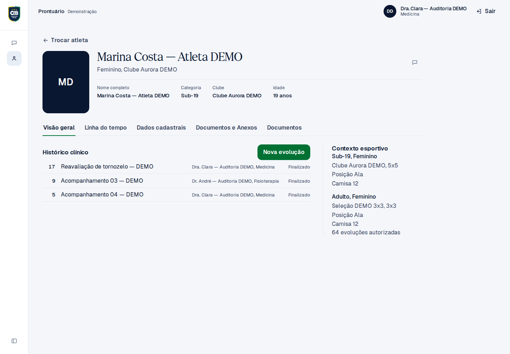

# HANDOFF 007.9A — Auditoria de UX do Perfil do Atleta

**Projeto:** Prontuário CBB · **Data:** 18/11/2026 · **Modalidade:** inspeção, sem implementação.

**Diagnóstico:** a direção aprovada está presente na interface real e deve ser preservada. O perfil permite operar evoluções, documentos e anexos, mas ainda exige esforço para localizar informações, compreender as seções e retomar uma atividade específica. Não foi identificado bloqueante P0 nos cenários avaliados. Foram registrados **8 achados P1 e 3 P2**. Isso não equivale a certificação de segurança ou homologação integrada.

## 1. Base e método

Inspeção da aplicação Next.js real em `http://127.0.0.1:3100`, conectada ao Supabase/Storage local. Base de código: commit `88fe671`, com as alterações longitudinais preexistentes no workspace preservadas. A rota de referência `/design-lab/clinical-north-star` foi usada como direção visual, não como prova funcional. A página auditada foi `/atletas/[id]`.

Aplicadas as skills locais `frontend-design`, `web-design-guidelines` e `webapp-testing`, utilizando Playwright JS conforme o AGENTS.md do projeto. As [Web Interface Guidelines](https://raw.githubusercontent.com/vercel-labs/web-interface-guidelines/main/command.md) foram consultadas como apoio à revisão de acessibilidade e interação.

Foram criados exclusivamente dados fictícios temporários:

| Cenário | Composição |
|---|---|
| Prontuário extenso e multidisciplinar | 65 evoluções de medicina/fisioterapia, incluindo um rascunho de outra pessoa; 64 visíveis à médica auditora |
| Registro restrito | Uma evolução adicional de psicologia, acessível somente à autora |
| Documentos e anexos | Cinco documentos médicos privados, dos três tipos; um PDF de laudo, com upload e visualização reais |
| Recém-cadastrado | Atleta sem nascimento, vínculos ou registros clínicos |
| Múltiplos vínculos | Dois vínculos vigentes, em 5x5 e 3x3, e um encerrado em 2025 |
| Perfis profissionais | Medicina habilitada para documentos, fisioterapia, psicologia e cadastro sem leitura clínica |

Desktop: **1440×1000**. Mobile: **390×844**, com verificação adicional de documentos em **320×740**. Capturas finais em locale `pt-BR`. As figuras não contêm pacientes reais nem metadados dos registros privados de terceiros.

A avaliação combinou navegação, inspeção de DOM/HTML e RPC autenticada, abertura dos três editores médicos, PDF em canvas, teclado e axe-core. Os dados brutos estão em [observations.json](../visual/handoff-007-9a/observations.json), [acessibilidade e navegação](../visual/handoff-007-9a/accessibility-and-navigation.json) e [indicador de restrição](../visual/handoff-007-9a/restriction-indicator.json). `pass: false` nesses arquivos significa que a expectativa de UX não foi satisfeita; não é uma falha de execução da coleta.

## 2. Capturas reais

| Evidência obrigatória | Captura |
|---|---|
| 1. Perfil, visão inicial | [Desktop](../visual/handoff-007-9a/01-perfil-inicial-desktop.png) |
| 2. Dados pessoais e esportivos | [Cadastro completo](../visual/handoff-007-9a/02-dados-pessoais-esportivos-desktop.png), [múltiplos vínculos](../visual/handoff-007-9a/10-multiplos-vinculos.png) |
| 3. Linha do tempo | [Lista](../visual/handoff-007-9a/03-linha-do-tempo-desktop.png), [registro aberto](../visual/handoff-007-9a/03b-evolucao-aberta.png), [resultado do link recente](../visual/handoff-007-9a/03a-timeline-link-recente.png) |
| 4. Documentos médicos | [Lista](../visual/handoff-007-9a/04-documentos-medicos-desktop.png), [prescrição](../visual/handoff-007-9a/04b-documento-editor.png), [pedido cirúrgico](../visual/handoff-007-9a/04c-pedido-cirurgico.png), [solicitação de exames](../visual/handoff-007-9a/04d-solicitacao-exames.png) |
| 5. Anexos clínicos | [Lista](../visual/handoff-007-9a/05-anexos-clinicos-desktop.png), [PDF aberto](../visual/handoff-007-9a/05b-anexo-aberto.png) |
| 6. Ações rápidas | [Nova evolução e acesso ao chat](../visual/handoff-007-9a/06-acoes-rapidas-desktop.png), [contexto no Intelligence](../visual/handoff-007-9a/08-integracao-intelligence.png) |
| 7. Mobile | [Inicial](../visual/handoff-007-9a/07a-mobile-inicial.png), [cadastro](../visual/handoff-007-9a/07b-mobile-cadastro.png), [timeline](../visual/handoff-007-9a/07c-mobile-timeline.png), [documentos](../visual/handoff-007-9a/07d-mobile-documentos.png), [anexos](../visual/handoff-007-9a/07e-mobile-anexos.png), [320 px](../visual/handoff-007-9a/07f-mobile-320-documentos.png) |

Capturas complementares: [atleta novo](../visual/handoff-007-9a/09-atleta-recem-cadastrado.png), [fisioterapia](../visual/handoff-007-9a/11-fisioterapia-perfil.png), [cadastro sem leitura clínica](../visual/handoff-007-9a/12-cadastro-sem-leitura-clinica.png).

## 3. O que existe e deve ser preservado

| Área inspecionada | Constatação |
|---|---|
| Identificação e esporte | Nome, categoria, clube e idade no masthead; vínculos vigentes, modalidade, posição e camisa na coluna contextual; histórico esportivo no cadastro |
| Dados pessoais e contatos | Identidade de gênero, identificador, telefone, e-mail, responsável e emergência disponíveis no cadastro; formulário de edição básica e foto condicionado à permissão |
| Histórico clínico | Visão geral com três evoluções recentes autorizadas; timeline com agrupamento por mês, autoria, especialidade e estado; conteúdo expansível |
| Evoluções | Ação Nova evolução abre o atleta correto; revisão do próprio rascunho está implementada; finalizados e rascunhos têm estados distintos |
| Prescrições, cirurgia e exames | Os três fluxos e editores existem; mantêm o nome do atleta; a lista avisa explicitamente que os documentos não são emitidos nem assinados |
| Anexos | Upload, pesquisa, categorias, ordenação, paginação, edição/retirada previstas no módulo existente; a auditoria abriu um PDF real. Não se deve confundir anexo com documento médico emitido |
| Permissões | Medicina habilitada vê seus documentos. Fisioterapia pode evoluir, mas não acessa documentos privados da médica. Cadastro sem leitura clínica não vê timeline nem ação de evolução |
| CBB Intelligence | O ícone do masthead leva ao chat e o contexto do atleta é mantido. A URL pode ser consumida/normalizada depois da seleção; a evidência é o contexto renderizado, não a permanência de `?atleta=` |
| Resumo e lesões | O perfil apresenta atividades recentes, não um resumo clínico validado nem um cadastro estruturado de lesões. Informações assistenciais podem estar nas evoluções. Existe implementação de análise longitudinal no Intelligence no workspace; não é correto declarar que o projeto inteiro não possui análise longitudinal |

A identidade CBB, o título Geist Serif de **32 px**, os títulos de seção Geist Sans de **17 px**, a leitura editorial da timeline e o contexto esportivo lateral foram confirmados no navegador. Não há justificativa para substituir essa composição por outro redesign.

Os espaços livres da visão geral são em grande parte consequência de mostrar somente três eventos. Não proponho preenchê-los com cards ou informações clínicas deduzidas.

## 4. P0 — Bloqueantes

**Nenhum P0 observado neste recorte.** Não houve falha reproduzida de troca indevida de atleta, exposição de documentos de terceiros ou acesso clínico pelo perfil exclusivamente cadastral.

O título e o UUID do registro restrito ficaram ausentes tanto do HTML quanto da resposta da RPC da médica. Fisioterapia e cadastro também não receberam esses metadados na timeline. A própria autora conseguiu acessar seu registro. As URLs de listagem médica e de documento individual retornaram 404 aos três perfis sem habilitação. O anexo privado da médica não apareceu para fisioterapia.

Essas verificações cobrem os cenários descritos; não substituem uma auditoria completa de segurança ou a matriz institucional de permissões.

## 5. P1 — Recomendações importantes

### UX-01 — O link recente não abre a evolução de destino

- **Problema e evidência:** clicar na primeira evolução da visão geral chega a `#registro-…`, mas nenhum `details` fica aberto. [Captura](../visual/handoff-007-9a/03a-timeline-link-recente.png). A página gera o fragmento na linha 182, enquanto a expansão depende do parâmetro `registro`, lido na linha 49 e usado na linha 225 de `src/app/(workspace)/atletas/[id]/page.tsx`.
- **Impacto:** o profissional chega ao local, mas precisa descobrir que deve clicar novamente para ler a fonte.
- **Solução proposta:** alinhar o link ao contrato existente de expansão; preservar retorno, rolagem e foco no registro autorizado.
- **Complexidade:** baixa. **Componentes:** perfil, links de atividade recente e `details` da timeline.

### UX-02 — A aba ativa fica escondida no mobile

- **Problema e evidência:** em 390 px, a navegação mede 358 px e contém 702 px de abas; ao entrar em Documentos, `scrollLeft=0` e a aba ativa fica fora da área visível. [Captura](../visual/handoff-007-9a/07g-mobile-documentos-ptbr.png). Regra em `src/app/globals.css:355`.
- **Impacto:** o usuário não enxerga onde está nem percebe facilmente que há outras seções, incluindo anexos e documentos médicos.
- **Solução proposta:** revelar a aba atual, sinalizar a continuidade horizontal e preservar operação por teclado; avaliar seletor compacto com as mesmas seções no mobile.
- **Complexidade:** baixa/média. **Componentes:** navegação de seções e CSS responsivo.

### UX-03 — Alterações cadastrais podem ser perdidas sem aviso

- **Problema e evidência:** alterar o nome sem salvar e trocar de aba restaura o valor anterior; recarregar também perde a alteração, sem diálogo. Medido nos dois JSONs de navegação. O formulário em `page.tsx:269` não oferece proteção de saída.
- **Impacto:** retrabalho e incerteza sobre o que foi salvo.
- **Solução proposta:** estado de alteração pendente e confirmação de descarte ao sair; aviso de sucesso somente após a operação existente; não acrescentar salvamento clínico automático.
- **Complexidade:** média. **Componentes:** formulário cadastral e transições de seção; manter `edit-actions.ts` e sua autorização.

### UX-04 — “Documentos” e “Documentos e Anexos” competem

- **Problema e evidência:** duas abas próximas usam “Documentos” para tarefas diferentes; o upload se chama “Adicionar documento”. [Lista médica](../visual/handoff-007-9a/04-documentos-medicos-desktop.png), [anexos](../visual/handoff-007-9a/05-anexos-clinicos-desktop.png). Referências: `page.tsx:115` e `src/features/attachments/module.tsx:63`.
- **Impacto:** aumenta a tentativa e erro para encontrar uma prescrição ou um laudo enviado.
- **Solução proposta:** testar “Documentos médicos” e “Anexos clínicos”, com “Adicionar anexo”; preservar o aviso de rascunho não assinado e não renomear estados clínicos.
- **Complexidade:** baixa. **Componentes:** rótulos de abas, heading e ação de upload; sem alterar contratos.

### UX-05 — Contatos e esporte ficam atrás de formulários extensos

- **Problema e evidência:** o cadastro abre diretamente em edição e foto; no mobile, Contatos começa em cerca de **1440 px** e Histórico esportivo em **2516 px**. [Cadastro](../visual/handoff-007-9a/07b-mobile-cadastro.png). Telefone e e-mail são texto sem ação; o formulário básico só edita nome, nome social, nascimento e status. Contatos/identificador/gênero estão presentes, mas sem edição nessa tela. Para quem não edita, o nascimento completo também não é apresentado nesse corpo cadastral, embora a idade esteja no masthead.
- **Impacto:** consulta de emergência e manutenção cadastral exigem procura; “Salvar cadastro” sugere uma abrangência maior que a edição oferecida.
- **Solução proposta:** priorizar leitura, organizar Identificação, Contatos e Esporte, revelar edição sob demanda e tornar o alcance da ação explícito. Usar `tel:`/`mailto:` onde apropriado. Qualquer nova capacidade de alterar contatos exige escopo de domínio separado; não a simular com campos sem persistência.
- **Complexidade:** média para organização visual; nova edição de contatos fora do corte sugerido. **Componentes:** `page.tsx:264`, `PhotoEditor`, `SportLinkForm`, apresentação de contatos.

### UX-06 — Histórico extenso depende de rolagem e memória

- **Problema e evidência:** as 64 evoluções autorizadas são apresentadas sem filtro local de período/especialidade nem busca textual na timeline. A página chegou a **3447 px** no desktop e **6557 px** no mobile. [Timeline](../visual/handoff-007-9a/07c-mobile-timeline.png). Renderização em `page.tsx:208`; agrupamento mensal já existe.
- **Impacto:** localizar um episódio ou acompanhamento de uma especialidade exige varrer todo o histórico.
- **Solução proposta:** começar com navegação por mês e filtros sobre os dados já autorizados, estado e escopo visíveis e retorno ao item aberto. Revelação progressiva pode melhorar a leitura; não reduz o volume retornado pela RPC. Paginação real de banco exige trabalho separado se a carga institucional justificar.
- **Complexidade:** média. **Componentes:** lista/grupos da timeline e controles de navegação; não unificar fontes com permissões diferentes.

### UX-07 — Documentos do mesmo tipo ficam indistinguíveis na lista

- **Problema e evidência:** há duas linhas chamadas “Prescrição” e duas “Solicitação de exames”; a identificação se limita a tipo, estado e atualização. [Captura](../visual/handoff-007-9a/04-documentos-medicos-desktop.png). Renderização em `page.tsx:259`; contrato em `src/features/documents/data.ts:9`.
- **Impacto:** o médico abre documentos sucessivamente para encontrar o rascunho desejado.
- **Solução proposta:** hierarquia consistente de tipo, data/hora, estado e versão já disponíveis, agrupamento/filtro por tipo e ordenação clara. Resumo de conteúdo só deve entrar mediante contrato autorizado específico; não buscar indiscriminadamente o conteúdo de toda a lista.
- **Complexidade:** baixa/média com metadados atuais. **Componentes:** lista de documentos e rótulos; preservar ausência de assinatura/emissão.

### UX-08 — A autora não reconhece a restrição na linha do seu registro

- **Problema e evidência:** a autora vê o registro corretamente, mas o estado visível é somente “Finalizado”, sem indicação de privacidade. [Verificação sem conteúdo sigiloso](../visual/handoff-007-9a/restriction-indicator.json). O tipo `ClinicalRecord` tem `is_restricted`; a timeline em `page.tsx:231` não o apresenta.
- **Impacto:** confunde estado documental com abrangência de compartilhamento.
- **Solução proposta:** indicar a restrição apenas no registro já autorizado e retornado à própria autora. Nunca criar linha, contador, cadeado ou placeholder de registro oculto para terceiros.
- **Complexidade:** baixa. **Componentes:** metadados da timeline e eventual revisão do próprio registro; nenhuma alteração de permissão.

## 6. P2 — Refinamentos

### UX-09 — Nome e data da atividade recente podem ser mais precisos

- **Problema/evidência:** “Histórico clínico” mostra só três evoluções, com número do dia sem mês/ano. Documentos e anexos ficam fora desse bloco. `page.tsx:169` e `page.tsx:181`; [visão geral](../visual/handoff-007-9a/01-perfil-inicial-desktop.png).
- **Impacto:** a área parece mais abrangente que o conteúdo; datas atravessando meses podem ser ambíguas.
- **Proposta:** “Evoluções recentes”, data curta completa e link “Ver todas as evoluções”, sem sugerir ausência de documentos não consultados.
- **Complexidade:** baixa. **Componentes:** heading, datas e link da visão geral.

### UX-10 — Expansão e ações do masthead têm pouca sinalização

- **Problema/evidência:** a timeline remove o marcador nativo do `summary`; o chat é um ícone isolado. Ambos funcionam por teclado e o chat tem nome acessível. `globals.css:293`, `page.tsx:145`.
- **Impacto:** a possibilidade de abrir o conteúdo ou ir ao Intelligence depende de familiaridade com a interface.
- **Proposta:** affordance discreta de expandir/recolher e rótulo/tooltip de chat; revisar alvos de toque sem ampliar todos os blocos nem criar um menu global redundante.
- **Complexidade:** baixa. **Componentes:** `summary`, ação de chat e foco.

### UX-11 — Estado vazio orienta pouco a próxima ação

- **Problema/evidência:** o atleta novo informa ausência de registro e vínculo, mas não sugere completar os dados ou iniciar a evolução permitida. [Captura](../visual/handoff-007-9a/09-atleta-recem-cadastrado.png). A ação Nova evolução já existe para quem escreve.
- **Impacto:** o usuário entende o vazio, mas precisa deduzir a próxima tarefa.
- **Proposta:** instrução curta e contextual usando ações já autorizadas. Manter “disponível para seu perfil”; não afirmar que não existe qualquer registro do atleta.
- **Complexidade:** baixa. **Componentes:** estados vazios da visão geral e timeline.

## 7. Acessibilidade, responsividade e limites

- Axe-core, tags WCAG A/AA até 2.2: **zero violações reportadas nas cinco seções desktop**. Isso não certifica conformidade nem cobre leitores de tela ou todos os estados dinâmicos.
- A evolução abriu com Enter; o foco observado foi contorno de 3 px azul. Rótulos de formulário, nome acessível do chat e estados de rascunho/finalizado existem.
- Não houve overflow horizontal da página nas cinco seções em 390 px nem em Documentos a 320 px. A rolagem interna das abas é intencional; o problema UX-02 é a orientação e a aba atual oculta.
- Tipografia medida coerente com a direção aprovada. Não foi encontrada razão para trocar famílias ou introduzir nova escala tipográfica.
- As capturas mostram informações operacionais pequenas em alguns pontos; tamanho isolado não foi declarado falha WCAG. Preferir ajustes pontuais após validar com profissionais.
- Não foram realizados testes com pacientes reais, leitores de tela, Safari/iOS, pessoas usuárias ou carga institucional de documentos. Tempos de tarefa e satisfação ainda precisam de homologação com profissionais.
- O provedor de IA estava desabilitado no servidor de auditoria. Foi verificada a navegação e continuidade do contexto; a mensagem de indisponibilidade não é tratada como ausência da integração nem falha de UX do perfil. Não houve geração de análise ou alteração no agente.
- Upload/retirada, finalização e edição clínica não foram repetidos pela UI nesta auditoria. A implementação foi inspecionada, mas a avaliação não substitui os testes funcionais já homologados desses módulos.

## 8. Proposta de escopo para o Handoff 007.9B

**Objetivo:** melhorar orientação, consulta e continuidade sem substituir o Clinical Design North Star.

1. **Primeiro corte:** UX-01, UX-02, UX-03 e UX-04 — fonte abre corretamente, aba atual visível, proteção de alterações pendentes e nomenclatura inequívoca.
2. **Segundo corte:** UX-05 a UX-08 — leitura cadastral antes da edição, localização de contatos/esporte, navegação de histórico, lista médica mais distinguível e indicação de restrição exclusiva à autora autorizada.
3. **Polimento junto aos componentes tocados:** UX-09 a UX-11; não abrir uma frente independente de redesign.

**Fora do 007.9B proposto:** novo resumo clínico automático, modelagem de lesões, diagnósticos inferidos, assinatura/emissão, alteração de permissões, exposição da existência de registros ocultos, mudanças no agente, nova edição de contatos sem contrato próprio e paginação nova de banco. Se necessários, devem virar handoffs explícitos.

**Aceite proposto:** repetir os seis cenários desta auditoria; confirmar os três tipos de documento, fonte recente já expandida, contexto de atleta preservado, abas acessíveis em 320/390 px, descarte de alteração confirmado, dados vazios sem inferência, teclado/foco e ausência de metadados restritos. Manter os testes homologados e executar lint, typecheck e build quando houver implementação.

## 9. Estado da entrega

Foram produzidos somente relatório, capturas e medições. Nenhum arquivo de aplicação, backend, permissão, auditoria, documento ou agente foi alterado neste handoff. A preparação utilizou contas, atletas, documentos e um arquivo de Storage exclusivamente sintéticos e temporários; a remoção foi concluída e verificada (zero atletas, contas, documentos e anexos remanescentes desses identificadores). As leituras passaram pelas rotinas normais, sem suprimir a auditoria da aplicação.

Não houve merge, publicação nem implantação. As alterações anteriores do workspace permanecem preservadas. Como não há mudança de aplicação, não foram reexecutados lint/build ou a suíte clínica completa para produzir uma aparente homologação de código novo; foram executadas as inspeções específicas descritas acima.
