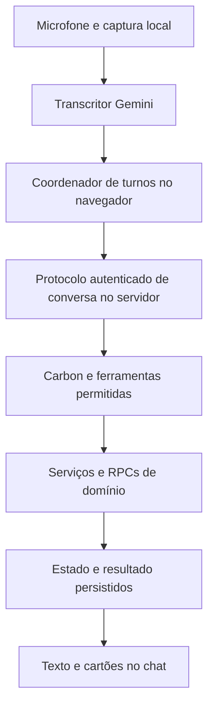

# Melhoria da entrada por voz no chat

Plano técnico para implementar entrada por voz fluida, com respostas exclusivamente em texto e cartões. O profissional pode fazer pausas, completar o relato e corrigir referências. Gemini Carbon interpreta tarefas; as permissões, confirmações e operações clínicas continuam no servidor.

Data: 22 de novembro de 2026. Base analisada: commit `ce14154`. Branch de trabalho criada: `feat/voice-conversation-fluidity`. Este pacote contém planejamento e prompts; sua existência não significa que a implementação foi concluída.

## Decisões de escopo

- Manter `gemini-3.5-transcribe-live` para transcrição e adotar `gemini-4-carbon` para o agente textual, com configuração explícita e validação da integração.
- Não implementar síntese de voz, resposta falada, agente Live adicional, telefonia nem armazenamento de áudio.
- Reaproveitar domínio, ferramentas, cartões, permissões, auditoria, idempotência e fluxos tradicionais existentes.
- Melhorar o mesmo agente usado por texto e voz. Não criar um segundo conjunto de permissões para voz.
- Preservar as restrições atuais de assinatura e entrega. A confirmação por voz de assinatura continua indisponível onde já é bloqueada.
- Trabalhar em branch. Este pacote não autoriza integração na main nem publicação do Beta.
- A homologação com microfone físico e Carbon real é distinta de testes com transportes simulados.

## Ordem dos chats

Execute um chat por vez, na mesma branch e no mesmo checkout. Não execute esses prompts em paralelo: eles alteram componentes compartilhados.

| Ordem | Prompt | Dependência | Modelo sugerido |
| --- | --- | --- | --- |
| 01 | [Continuidade imediata](prompts/01-continuidade.md) | Base limpa e documentação lida | Sol, esforço alto |
| 02A | [Persistência e estado dos turnos](prompts/02a-estado-servidor.md) | 01 concluída | Sol, esforço alto |
| 02B | [Integração das rotas e ferramentas](prompts/02b-integracao-servidor.md) | 02A concluída | Sol, esforço alto |
| 03 | [Coordenador no cliente](prompts/03-coordenador-cliente.md) | 02B concluída | Sol, esforço alto |
| A | [Revisão de concorrência e segurança](prompts/revisao-a.md) | 03 concluída | Astra, esforço alto |
| 04 | [Pausas e modos de captura](prompts/04-captura.md) | Revisão A aprovada | Sol, esforço médio ou alto |
| 05 | [Conexão e recuperação](prompts/05-recuperacao.md) | 04 concluída | Sol, esforço alto |
| 06 | [Carbon e referências naturais](prompts/06-carbon.md) | 05 concluída | Sol, esforço alto |
| 07 | [Edição conversacional segura](prompts/07-edicao-natural.md) | 06 concluída | Sol, esforço alto |
| B | [Revisão da interpretação e das operações](prompts/revisao-b.md) | 07 concluída | Astra, esforço alto |
| 08 | [Feedback, limites e métricas](prompts/08-feedback-metricas.md) | Revisão B aprovada | Sol, esforço médio ou alto |
| 09 | [Regressão e homologação](prompts/09-homologacao.md) | 08 concluída | Sol, esforço alto |

A sugestão de modelo é operacional; os testes e revisões determinam o aceite. Uma etapa não está pronta apenas porque seu executor declarou sucesso.

## Como usar

Abra um chat no projeto e cole o conteúdo do arquivo de prompt correspondente. Cada prompt manda ler este pacote e os relatórios anteriores; não depende da memória deste chat.

Leia também [os contratos](CONTRATOS.md), [os cenários de aceite](ACEITE.md) e [as regras dos executores](REGRAS.md). Para as revisões, cole o prompt da revisão no chat com Astra.

Se uma etapa estiver incompleta, continue nela. Não use o prompt seguinte para absorver trabalho pendente. Correções apontadas nas revisões voltam ao executor responsável e são reavaliadas.

Cada execução produz `docs/delivery/voice-fluidity/NN.md`, com commit, testes, resultados e limitações. As revisões produzem `revisao-a.md` e `revisao-b.md` no mesmo diretório. Esses relatórios ainda não foram produzidos.

## Arquitetura escolhida



O navegador controla captura e apresentação. O servidor controla conversa, referências e andamento de operações. O modelo propõe intenções; não concede autorização e não decide se uma gravação ocorreu.

A correção rápida de persistência da etapa 01 é transitória. A etapa 03 migra o envio para o protocolo das etapas 02A e 02B e remove a dupla responsabilidade de persistir turnos.

## Achados que motivam o plano

| Evidência na base | Consequência | Etapas |
| --- | --- | --- |
| `voice/transcription.ts`: espera de 1600 ou 3000 ms, além do silêncio do transcritor | Demora antes de enviar | 04 |
| `voice/use-voice-session.ts`: fila concatenada quando busy | Correções misturadas e nova fala invisível | 03 e 04 |
| `intelligence-home.tsx`: libera pending antes de concluir queuePersist | Possível próximo turno com histórico incompleto | 01 a 03 |
| `security.ts`: reconstrói histórico com sete mensagens anteriores | Necessidade de estado explícito da tarefa | 02 e 06 |
| `agent.ts`: retém deltas para todo perfil médico | Espera sem retorno útil | 08 |
| `operations/document-intent.ts`: sintaxe rígida de edição | Linguagem natural cai em esclarecimento repetitivo | 06 e 07 |
| `api/inteligencia/route.ts`: 20 requisições por usuário em dez minutos, em memória | Bloqueio durante conversas e comportamento diferente entre instâncias | 08 |
| `operations/server.ts`: gateway recebe a confirmação humana original e bloqueia confirmação de assinatura por voz | Proteção obrigatória a preservar | Todas |
| Relatórios de homologação usam frases sintetizadas | Não comprovam fluidez com pessoas | 09 |

A disputa de persistência é uma hipótese fundamentada no código e precisa ser reproduzida na etapa 01. Os demais comportamentos citados são verificáveis na base; revalide se ela tiver mudado.

## Resultado esperado

Uma jornada deve localizar um atleta, resolver homônimos, consultar registros, acumular um ditado com pausas, preparar uma proposta, corrigir um campo e salvar um rascunho pelo fluxo humano já permitido. A interface precisa dizer o que está fazendo e recuperar quedas sem duplicar operações.

As mudanças não podem tornar um histórico revogado acessível, transformar “sim” em autorização genérica, apagar texto pendente nem afirmar sucesso antes do resultado do servidor.

## Prompt curto para iniciar

Cole no primeiro chat executor:

```text
Execute somente a etapa 01 do plano de melhoria da voz.
Localize o repositório pelas instruções locais e leia AGENTS.md.
Leia docs/specs/voice-fluidity/README.md e o prompt
 docs/specs/voice-fluidity/prompts/01-continuidade.md.
Siga esse prompt integralmente e conclua apenas a etapa 01.
Não avance para outras etapas nem publique a main.
```

Para o próximo chat, use o prompt indicado na tabela, após conferir o relatório e o checkpoint anterior. Não cole só uma descrição resumida da tarefa: mantenha a referência ao arquivo de prompt completo.
